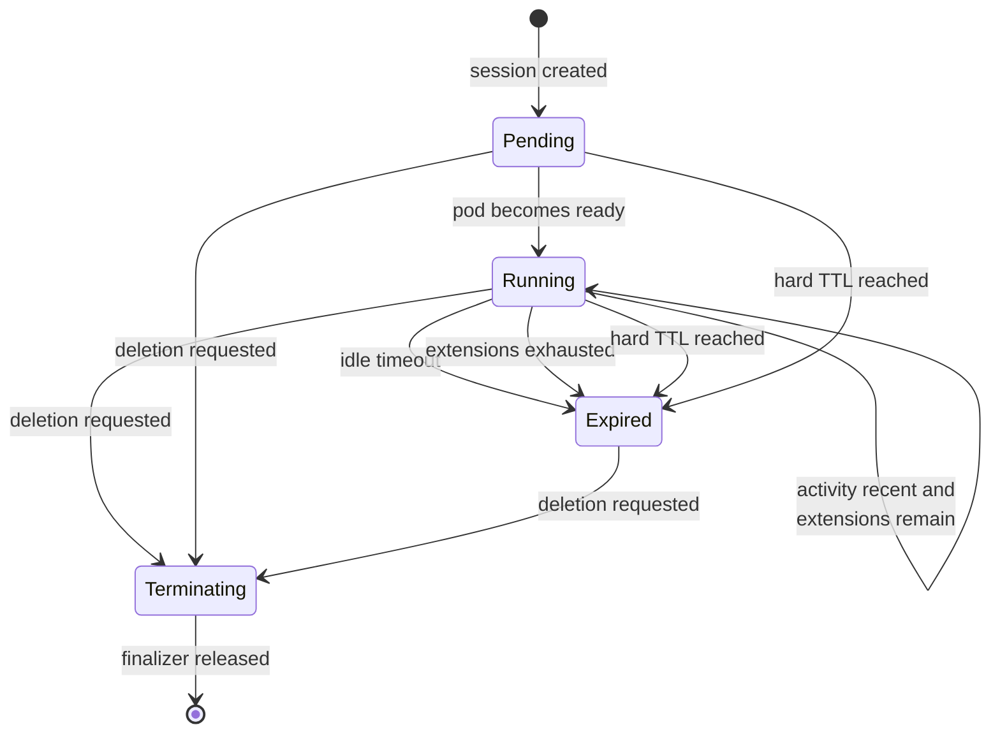

# WorkspaceSession Operator

[](https://github.com/Smoothy123/workspace-session-operator/actions/workflows/test.yml)
[](https://github.com/Smoothy123/workspace-session-operator/actions/workflows/lint.yml)
[](https://github.com/Smoothy123/workspace-session-operator/actions/workflows/test-e2e.yml)
[](LICENSE)

A Kubernetes operator that gives ephemeral developer workspaces a self-enforcing
lifetime: they expire on idle, may be extended a bounded number of times, and
can never outlive a hard TTL.

## The problem

Dev environments are cheap to create and easy to forget. A preview environment
per pull request, a cloud IDE per engineer, a sandbox for a demo that finished
three weeks ago — they get spun up constantly and torn down rarely, because
deleting them is always somebody else's job and never urgent. The bill arrives
anyway.

The usual fix is a nightly reaper cron that deletes anything older than N hours.
That is blunt: it kills sessions people are actively using, and it leaves a
window where abandoned ones keep burning money.

This operator moves the decision into the environment itself. A `WorkspaceSession`
declares how long it may sit idle, how much extra time activity buys it, how many
times it may be extended, and the ceiling it can never pass. The controller then
enforces exactly that.

## What it does

- Reconciles a `WorkspaceSession` into a **Pod** and a **Service**, each owned by
  the session via a controller `ownerReference`.
- **Requeues itself at the expiry timestamp** with `RequeueAfter` — no polling
  loop, no cron. The controller sleeps until the moment a decision is due.
- On waking: **extends** the session if activity is recent and extensions remain,
  otherwise **tears it down**.
- A **finalizer** withdraws the Service before deleting the Pod, so no request
  lands on a terminating backend.
- Expired sessions are kept as **tombstones** — `kubectl get ws` still shows what
  ended and why.

## Lifecycle



`Expired` is terminal and absorbing. Activity arriving after expiry never
resurrects a session.

## Quickstart

Requires Go 1.26+, Docker, [kind](https://kind.sigs.k8s.io/), and kubectl.

```bash
kind create cluster --name wsop
make install          # install the CRD
make run              # run the controller against the cluster
```

In another shell:

```bash
./hack/demo.sh
```

The sample uses deliberately short durations — 2 minute idle timeout, 10 minute
hard TTL — so the whole lifecycle is observable in about four minutes instead of
four hours.

### What that actually prints

The following is real output from a kind cluster, not an illustration.

```

==> Creating the session
workspacesession.workspace.smoothy.dev/demo created
    pod ready after 13s
NAME   PHASE     ENDPOINT                              EXPIRES                EXT   AGE
demo   Running   demo.default.svc.cluster.local:8080   2026-10-11T06:29:09Z   0     13s

==> Children created by the operator
NAME       READY   STATUS    RESTARTS   AGE
pod/demo   1/1     Running   0          13s

NAME           TYPE        CLUSTER-IP     EXTERNAL-IP   PORT(S)    AGE
service/demo   ClusterIP   10.96.45.143   <none>        8080/TCP   13s

==> Each child is owned by the session, so Kubernetes can garbage-collect it
WorkspaceSession/demo controller=true

==> Recording activity (what a session gateway would do)
workspacesession.workspace.smoothy.dev/demo annotated

==> Waiting out the idle window to watch the session extend
    extended after 102s
NAME   PHASE     ENDPOINT                              EXPIRES                EXT   AGE
demo   Running   demo.default.svc.cluster.local:8080   2026-10-11T06:31:09Z   1     2m

==> Going quiet so the session expires
    expired after 114s
NAME   PHASE     ENDPOINT   EXPIRES                EXT   AGE
demo   Expired              2026-10-11T06:31:09Z   1     4m

==> Children are gone, the tombstone remains with the reason
    children removed after 2s
No resources found in default namespace.
  Conditions:
    Last Transition Time:  2026-10-11T06:31:09Z
    Message:               Session has expired
    Reason:                IdleTimeout
    Status:                False
    Type:                  Ready
    Last Transition Time:  2026-10-11T06:31:09Z
    Message:               No activity within the idle timeout
    Reason:                IdleTimeout
    Status:                True
    Type:                  Expired
  Expires At:              2026-10-11T06:31:09Z
  Extensions Used:         1
  Last Activity At:        2026-10-11T06:27:22Z
  Phase:                   Expired
Events:
  Type    Reason           Age   From                         Message
  ----    ------           ----  ----                         -------
  Normal  SessionCreated   4m1s  workspacesession-controller  Workspace session started, expires at 2026-10-11T11:59:09+05:30
  Normal  SessionExtended  2m1s  workspacesession-controller  Extended to 2026-10-11T12:01:09+05:30 (1 of 2 extensions used)
  Normal  SessionExpired   1s    workspacesession-controller  Session expired: No activity within the idle timeout

==> Cleaning up
workspacesession.workspace.smoothy.dev "demo" deleted from default namespace
```

### Keeping a session alive

Activity is a timestamp in an annotation, so a keep-alive is one command:

```bash
kubectl annotate ws demo \
  workspace.smoothy.dev/last-activity=$(date -u +%FT%TZ) --overwrite
```

## API reference

`workspace.smoothy.dev/v1alpha1`, kind `WorkspaceSession`, short name `ws`.

### Spec

| Field | Type | Default | Meaning |
|---|---|---|---|
| `image` | string | *required* | Container image backing the workspace |
| `port` | int32 | `8080` | Port the workspace listens on |
| `idleTimeout` | duration | `30m` | Time without activity before the session may expire |
| `extensionDuration` | duration | `30m` | Lifetime granted by each extension |
| `maxExtensions` | int32 | `3` | Cap on extensions; `0` means never extend |
| `hardTTL` | duration | `4h` | Absolute ceiling, measured from `creationTimestamp` |

### Status

| Field | Type | Meaning |
|---|---|---|
| `phase` | enum | `Pending` \| `Running` \| `Expired` \| `Terminating` |
| `expiresAt` | time | When the controller next wakes to decide |
| `lastActivityAt` | time | Most recent activity; only ever moves forward |
| `extensionsUsed` | int32 | Extensions consumed so far |
| `endpoint` | string | In-cluster address of the Service |
| `conditions` | []Condition | `Ready` and `Expired`, the latter carrying the reason |

Example:

```yaml
apiVersion: workspace.smoothy.dev/v1alpha1
kind: WorkspaceSession
metadata:
  name: demo
spec:
  image: nginx:1.27-alpine
  port: 8080
  idleTimeout: 2m
  extensionDuration: 2m
  maxExtensions: 2
  hardTTL: 10m
```

## How the reconcile loop works

All expiry logic lives in one pure function, `Decide`, in
[`internal/controller/lifecycle.go`](internal/controller/lifecycle.go). It takes
no client, no context and no wall clock:

```go
func Decide(now, createdAt time.Time, spec DecisionSpec, st DecisionState) Decision
```

Its precedence, in order:

```
hardDeadline := createdAt + hardTTL

1. now >= hardDeadline              -> Expire{HardTTLExceeded}
2. expiresAt == nil                 -> Init{min(now + idleTimeout, hardDeadline)}
3. now <  expiresAt                 -> Wait{requeue: expiresAt - now}
   --- at or past expiry ---
4. activity stale or absent         -> Expire{IdleTimeout}
5. extensionsUsed >= maxExtensions  -> Expire{ExtensionsExhausted}
6. otherwise                        -> Extend{min(now + extensionDuration, hardDeadline)}
```

Three details that are easy to get wrong:

- **The hard TTL is checked first**, so it strictly dominates every other rule.
  An actively used session with extensions to spare still dies at the ceiling.
- **Both `Init` and `Extend` clamp to the hard deadline** rather than re-checking
  it afterwards. Clamping is what makes rule 1 unbeatable — a generous
  `extensionDuration` cannot schedule a wake-up past the ceiling in the first
  place.
- **`Init` does not consume an extension.** Establishing the first idle window is
  not an extension, and conflating the two would silently cost the user one.

`Reconcile` is then thin: read state, call `Decide`, apply the result.

## Design notes

### Why activity arrives as an annotation

The operator owns *lifecycle*, not *traffic detection*. Activity enters through a
single documented seam — an RFC3339 timestamp in
`workspace.smoothy.dev/last-activity` — which in a real deployment would be
written by the ingress proxy or session gateway that already terminates workspace
connections.

Two alternatives were considered and rejected. An HTTP heartbeat endpoint on the
manager adds an unconvincing auth story and forces a port-forward into every
demo. Deriving activity from pod metrics needs metrics-server and produces
fragile code for little benefit.

Timestamps only ever move forward. A gateway retrying an old request, or two
gateways racing, can write a timestamp older than one already recorded; letting
that win would shorten a session someone is actively using. A malformed value is
logged and surfaced as a Warning event, then ignored — never fatal, because
stranding every workspace a buggy gateway touches is far worse than one
un-extended session.

### What the finalizer actually buys

**OwnerReferences, not the finalizer, perform garbage collection.** Both the Pod
and the Service carry a controller `ownerReference`, so Kubernetes would reclaim
them on its own. Presenting the finalizer as the thing that makes cleanup work
would be inaccurate.

It buys two things garbage collection does not:

1. **Ordering.** The Service delete is issued before the Pod delete. Be precise
   about what that is worth: the two API calls are microseconds apart, and
   EndpointSlice removal still has to propagate through the endpoint controller
   and every kube-proxy. This *narrows* the window in which a request reaches a
   terminating backend; it does not close it. Closing it would need a real drain
   wait between the two deletes.
2. **A terminal status window.** Phase, conditions and a final event are written
   before the object disappears.

The finalizer releases once both children are *marked for deletion*, not once
they are fully gone. Waiting for final removal would make teardown depend on a
kubelet confirming pod termination, so a workspace on an unreachable node would
strand its `WorkspaceSession` indefinitely. A finalizer that can deadlock on an
unhealthy node is worse than one that releases a moment early.

### Why the decision core is a pure function

Because it makes the interesting part testable without a cluster. Precedence,
clamping, the off-by-one on `maxExtensions`, the boundary where activity is
exactly `idleTimeout` old — all of it is exercised by table-driven unit tests
that run in microseconds. The reconciler is left with plumbing, which is what
integration tests are for.

## Testing

```bash
make test        # unit tests + envtest integration suite
make test-e2e    # full e2e against a kind cluster
make lint
```

Two layers, deliberately:

- **Unit tests** cover `Decide` exhaustively — hard-TTL precedence, clamping,
  exhausted extensions, `maxExtensions: 0`, absent activity, future-dated
  activity, and the `>=` staleness boundary. No API server involved.
- **Integration tests** run the real reconciler under
  [envtest](https://book.kubebuilder.io/reference/envtest.html) with an injected
  fake clock, so expiry and extension paths are exercised without waiting real
  time. Note that envtest runs only kube-apiserver and etcd — there is no
  kube-controller-manager, so ownerReference garbage collection is *not*
  exercised there.
- **End-to-end tests** run against a real kind cluster with the manager deployed.
  One spec covers garbage collection specifically: it creates a session, strips
  the finalizer so the operator's own teardown cannot do the cleaning, deletes
  the session, and asserts Kubernetes reclaims both children on the
  ownerReferences alone.

Because the fake clock does not wake the controller on its own (a pending
`RequeueAfter` was scheduled against real time), clock-dependent specs advance
the clock and then enqueue a reconcile explicitly.

## Limitations

- **No real traffic detection.** Activity must be written by something external.
  That boundary is deliberate, but it does mean the operator is only half of a
  working system.
- **No persistence.** Workspaces are stateless pods; there are no volumes, no
  snapshots, and no hibernate/resume.
- **No multi-tenancy.** No quotas, no per-user limits, no authentication.
- **Single-replica controller.** Leader election is left at the kubebuilder
  default and HA has not been tested.
- **`v1alpha1` with no conversion webhooks.** The API will change without a
  migration path.

## Project layout

```
api/v1alpha1/           CRD types, markers, conditions
internal/controller/
  lifecycle.go          Decide() — the pure decision core
  resources.go          Pod and Service builders
  activity.go           annotation parsing and monotonic activity
  workspacesession_controller.go   Reconcile, teardown, finalizer
config/                 CRD, RBAC, manager manifests (kustomize)
hack/demo.sh            scripted lifecycle walkthrough
test/e2e/               end-to-end suite against kind
docs/superpowers/       design spec and implementation plan
```

## Licence

Apache 2.0. See [LICENSE](LICENSE).
