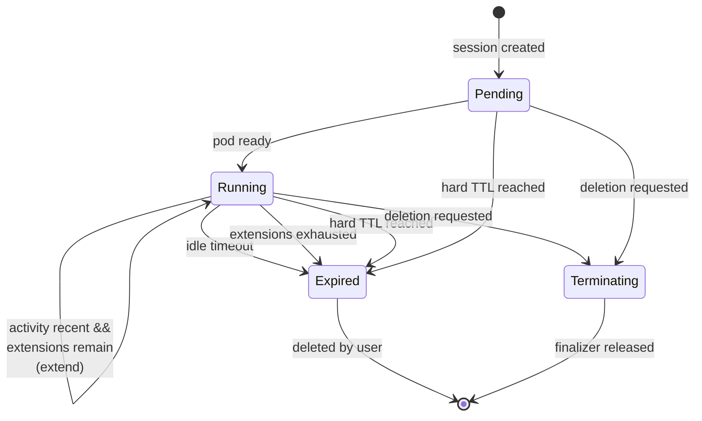

# WorkspaceSession Operator Implementation Plan

> **For agentic workers:** REQUIRED SUB-SKILL: Use superpowers:subagent-driven-development (recommended) or superpowers:executing-plans to implement this plan task-by-task. Steps use checkbox (`- [ ]`) syntax for tracking.

**Goal:** Build a Kubernetes operator that manages ephemeral developer workspaces, expiring them on idle timeout, bounded extensions, and an absolute TTL.

**Architecture:** A kubebuilder-scaffolded controller reconciles a `WorkspaceSession` CRD into a Pod and a Service, then requeues itself at the session's expiry timestamp. All expiry logic lives in a pure `Decide()` function with no client, context, or wall clock, so it is table-tested without a cluster. The reconciler holds an injectable `clock.PassiveClock` so envtest can fast-forward time. A finalizer provides ordered teardown; ownerReferences provide garbage collection.

**Tech Stack:** Go 1.27, kubebuilder v4.16.0, controller-runtime, Ginkgo/Gomega + envtest, kind v0.33.0, GitHub Actions.

**Spec:** `docs/superpowers/specs/2026-10-11-workspace-session-operator-design.md`

## Global Constraints

- Module path: `github.com/Smoothy123/workspace-session-operator`
- API group/version/kind: `workspace.smoothy.dev/v1alpha1`, `WorkspaceSession`, shortname `ws`
- Kubebuilder domain flag: `--domain smoothy.dev`, group flag: `--group workspace`
- Activity annotation key: `workspace.smoothy.dev/last-activity` (RFC3339 value)
- Finalizer: `workspace.smoothy.dev/teardown`
- Go 1.27; every commit must leave `make fmt vet test build` passing
- Git identity is already set repo-locally to `Smoothy123 <kamalapuramthanmai@gmail.com>` — do not change it, do not set it globally
- All commit messages end with `Co-Authored-By: Claude Opus 5 <noreply@anthropic.com>`
- `Expired` phase is terminal and absorbing — never transition out of it
- `ActionInit` must NOT increment `extensionsUsed`
- Activity staleness boundary is `>=`: activity exactly `idleTimeout` old counts as stale
- Every requeue duration is floored at `MinRequeue = 1 * time.Second`

## Deviations From The Spec

One, found while planning and flagged to the reviewer.

**§6 says the finalizer "only removes the finalizer once both are confirmed
gone."** This plan relaxes that to *absent or already marked for deletion*.
Waiting for final removal makes the finalizer depend on a kubelet confirming
pod termination, so a workspace on an unreachable node would strand its
WorkspaceSession indefinitely — a finalizer that deadlocks on an unhealthy node
is worse than one that releases a moment early. Once the API server accepts the
delete, the Service has stopped routing and the Pod is terminating, which is
everything the ordering guarantee actually needs. It also happens to be what
makes the deletion specs runnable under envtest, which has no kubelet.

## Review Focus

Five input classes the spec implies but which no task's happy-path tests would otherwise exercise. Each has its test assigned to the task that owns the code.

1. **Malformed `last-activity` annotation** (e.g. `"not-a-timestamp"`) must be ignored with a Warning event, never wedge or error the reconcile — a bad annotation from a buggy gateway must not strand a workspace. → Task 5, Step 1.
2. **Activity timestamp moving backwards** (a stale gateway write with an older timestamp) must not reduce `status.lastActivityAt`; the later value wins. → Task 5, Step 5.
3. **Activity timestamp in the future** (writer clock skew) must not grant unbounded life — `hardTTL` still clamps and still terminates the session. → Task 2, Step 9.
4. **`hardTTL` shorter than `idleTimeout`** must clamp the very first expiry so a session never outlives its ceiling. → Task 2, Step 5.
5. **A user deletes the Pod out from under a live session** — `ensurePod` is idempotent and recreates it rather than leaving a Running session with no backend. → Task 4, Step 9.

---

### Task 1: Scaffold the project and define the API types

**Files:**
- Create: `go.mod`, `PROJECT`, `Makefile`, `Dockerfile`, `cmd/main.go`, `config/**` (all by kubebuilder)
- Create: `api/v1alpha1/workspacesession_types.go` (kubebuilder stub, then replaced)
- Create: `.gitignore`

**Interfaces:**
- Consumes: nothing (first task)
- Produces: `workspacev1alpha1.WorkspaceSession`, `.Spec` (`Image string`, `Port int32`, `IdleTimeout`, `ExtensionDuration metav1.Duration`, `MaxExtensions int32`, `HardTTL metav1.Duration`), `.Status` (`Phase WorkspaceSessionPhase`, `ExpiresAt`, `LastActivityAt *metav1.Time`, `ExtensionsUsed int32`, `Endpoint string`, `Conditions []metav1.Condition`); constants `LastActivityAnnotation`, `TeardownFinalizer`, `ConditionReady`, `ConditionExpired`, `PhasePending`, `PhaseRunning`, `PhaseExpired`, `PhaseTerminating`

- [ ] **Step 1: Scaffold the project**

The working directory already contains `docs/` and a git repo on `main`. Kubebuilder refuses to init in a non-empty directory unless told otherwise; `--force` is not needed because it only checks for Go files and `PROJECT`.

```bash
cd /Users/apple/workspace/kubernetes/workspace-session-operator
export PATH="/opt/homebrew/bin:$PATH"
kubebuilder init \
  --domain smoothy.dev \
  --repo github.com/Smoothy123/workspace-session-operator \
  --project-name workspace-session-operator
```

Expected: creates `go.mod`, `Makefile`, `Dockerfile`, `PROJECT`, `cmd/main.go`, `config/`.

If kubebuilder refuses because the directory is not empty, it is objecting to
`docs/`. Move it aside, init, then move it back:

```bash
mv docs ../ws-docs-tmp && kubebuilder init \
  --domain smoothy.dev \
  --repo github.com/Smoothy123/workspace-session-operator \
  --project-name workspace-session-operator && mv ../ws-docs-tmp docs
```

- [ ] **Step 2: Create the API and controller stubs**

```bash
kubebuilder create api \
  --group workspace \
  --version v1alpha1 \
  --kind WorkspaceSession \
  --resource --controller
```

Expected: creates `api/v1alpha1/workspacesession_types.go`, `internal/controller/workspacesession_controller.go`, `internal/controller/suite_test.go`.

Verify the generated group is correct:

```bash
grep -r "workspace.smoothy.dev" api/v1alpha1/groupversion_info.go
```

Expected: a `GroupVersion = schema.GroupVersion{Group: "workspace.smoothy.dev", Version: "v1alpha1"}` line.

- [ ] **Step 3: Replace the types file**

Overwrite `api/v1alpha1/workspacesession_types.go` entirely with:

```go
package v1alpha1

import (
	metav1 "k8s.io/apimachinery/pkg/apis/meta/v1"
)

const (
	// LastActivityAnnotation carries an RFC3339 timestamp of the most recent
	// activity against the workspace. An external session gateway writes it;
	// the controller only reads it. This annotation is the single seam between
	// traffic observation and lifecycle management.
	LastActivityAnnotation = "workspace.smoothy.dev/last-activity"

	// TeardownFinalizer guarantees the Service is withdrawn before the Pod is
	// deleted, and that terminal status is written before the object vanishes.
	// Note that ownerReferences, not this finalizer, perform garbage collection.
	TeardownFinalizer = "workspace.smoothy.dev/teardown"
)

// Condition types reported in status.conditions.
const (
	ConditionReady   = "Ready"
	ConditionExpired = "Expired"
)

// Condition reasons owned by this package. The expiry reasons
// (IdleTimeout, ExtensionsExhausted, HardTTLExceeded) deliberately live in
// internal/controller alongside the logic that produces them, so there is
// exactly one definition of each string.
const (
	ReasonPodReady    = "PodReady"
	ReasonPodNotReady = "PodNotReady"
)

// WorkspaceSessionPhase summarises where a session sits in its lifecycle.
// +kubebuilder:validation:Enum=Pending;Running;Expired;Terminating
type WorkspaceSessionPhase string

const (
	// PhasePending means the children exist but the Pod is not yet Ready.
	PhasePending WorkspaceSessionPhase = "Pending"
	// PhaseRunning means the Pod is Ready and the session is live.
	PhaseRunning WorkspaceSessionPhase = "Running"
	// PhaseExpired is terminal and absorbing: children have been deleted and
	// the object is retained as a tombstone explaining why the session ended.
	PhaseExpired WorkspaceSessionPhase = "Expired"
	// PhaseTerminating means deletion was requested and the finalizer is running.
	PhaseTerminating WorkspaceSessionPhase = "Terminating"
)

// WorkspaceSessionSpec defines the desired lifetime policy of a workspace.
type WorkspaceSessionSpec struct {
	// Image is the container image backing the workspace.
	// +kubebuilder:validation:MinLength=1
	Image string `json:"image"`

	// Port is the port the workspace container listens on.
	// +kubebuilder:validation:Minimum=1
	// +kubebuilder:validation:Maximum=65535
	// +kubebuilder:default=8080
	// +optional
	Port int32 `json:"port,omitempty"`

	// IdleTimeout is how long a session may go without activity before it
	// becomes eligible to expire.
	// +kubebuilder:default="30m"
	// +optional
	IdleTimeout metav1.Duration `json:"idleTimeout,omitempty"`

	// ExtensionDuration is the additional lifetime granted by each extension.
	// +kubebuilder:default="30m"
	// +optional
	ExtensionDuration metav1.Duration `json:"extensionDuration,omitempty"`

	// MaxExtensions caps how many times a session may be extended. Zero means
	// the session expires at its first idle check and is never extended.
	// +kubebuilder:validation:Minimum=0
	// +kubebuilder:default=3
	// +optional
	MaxExtensions int32 `json:"maxExtensions,omitempty"`

	// HardTTL is the absolute lifetime ceiling measured from creationTimestamp.
	// No extension can carry a session past it.
	// +kubebuilder:default="4h"
	// +optional
	HardTTL metav1.Duration `json:"hardTTL,omitempty"`
}

// WorkspaceSessionStatus reports observed lifecycle state.
type WorkspaceSessionStatus struct {
	// Phase is a coarse summary of lifecycle state.
	// +optional
	Phase WorkspaceSessionPhase `json:"phase,omitempty"`

	// ExpiresAt is when the controller will next wake and decide this session's
	// fate. It is always clamped to creationTimestamp + hardTTL.
	// +optional
	ExpiresAt *metav1.Time `json:"expiresAt,omitempty"`

	// LastActivityAt mirrors the most recent valid activity annotation. It only
	// ever moves forward.
	// +optional
	LastActivityAt *metav1.Time `json:"lastActivityAt,omitempty"`

	// ExtensionsUsed counts extensions granted so far. Establishing the initial
	// expiry window does not count as an extension.
	// +optional
	ExtensionsUsed int32 `json:"extensionsUsed,omitempty"`

	// Endpoint is the in-cluster address of the workspace Service.
	// +optional
	Endpoint string `json:"endpoint,omitempty"`

	// Conditions holds Ready and Expired.
	// +optional
	// +listType=map
	// +listMapKey=type
	Conditions []metav1.Condition `json:"conditions,omitempty"`
}

// +kubebuilder:object:root=true
// +kubebuilder:subresource:status
// +kubebuilder:resource:shortName=ws
// +kubebuilder:printcolumn:name="Phase",type=string,JSONPath=`.status.phase`
// +kubebuilder:printcolumn:name="Endpoint",type=string,JSONPath=`.status.endpoint`
// +kubebuilder:printcolumn:name="Expires",type=string,JSONPath=`.status.expiresAt`
// +kubebuilder:printcolumn:name="Ext",type=integer,JSONPath=`.status.extensionsUsed`
// +kubebuilder:printcolumn:name="Age",type=date,JSONPath=`.metadata.creationTimestamp`

// WorkspaceSession is an ephemeral developer workspace with a self-enforcing
// lifetime.
type WorkspaceSession struct {
	metav1.TypeMeta   `json:",inline"`
	metav1.ObjectMeta `json:"metadata,omitempty"`

	Spec   WorkspaceSessionSpec   `json:"spec,omitempty"`
	Status WorkspaceSessionStatus `json:"status,omitempty"`
}

// +kubebuilder:object:root=true

// WorkspaceSessionList contains a list of WorkspaceSession.
type WorkspaceSessionList struct {
	metav1.TypeMeta `json:",inline"`
	metav1.ListMeta `json:"metadata,omitempty"`
	Items           []WorkspaceSession `json:"items"`
}

func init() {
	SchemeBuilder.Register(&WorkspaceSession{}, &WorkspaceSessionList{})
}
```

- [ ] **Step 4: Generate deepcopy and CRD manifests**

```bash
make generate manifests
```

Expected: `api/v1alpha1/zz_generated.deepcopy.go` regenerated, `config/crd/bases/workspace.smoothy.dev_workspacesessions.yaml` written.

- [ ] **Step 5: Verify the CRD reflects the defaults and printer columns**

```bash
grep -E 'shortNames|30m|4h|default' config/crd/bases/workspace.smoothy.dev_workspacesessions.yaml | head -20
```

Expected: `ws` under shortNames, `default: 30m`, `default: 4h`, `default: 8080`, `default: 3`.

- [ ] **Step 6: Confirm it builds**

```bash
make build
```

Expected: compiles, produces `bin/manager`. The generated controller stub reconciles nothing yet — that is fine.

- [ ] **Step 7: Write .gitignore**

```bash
cat > .gitignore <<'EOF'
bin/
testbin/
cover.out
*.test
.DS_Store
__debug_bin*
EOF
```

- [ ] **Step 8: Commit**

```bash
git add -A
git commit -m "$(cat <<'MSG'
feat: scaffold operator and define WorkspaceSession API

Kubebuilder scaffold for workspace.smoothy.dev/v1alpha1, plus the full
CRD type: lifetime policy in spec (idleTimeout, extensionDuration,
maxExtensions, hardTTL) and observed lifecycle in status (phase,
expiresAt, lastActivityAt, extensionsUsed, conditions).

Printer columns make `kubectl get ws` readable without -o yaml.

Co-Authored-By: Claude Opus 5 <noreply@anthropic.com>
MSG
)"
```

---

### Task 2: The pure decision core

This is the highest-value task in the plan. Everything interesting about the lifecycle is decided here, in a function that touches no Kubernetes API.

**Files:**
- Create: `internal/controller/lifecycle.go`
- Test: `internal/controller/lifecycle_test.go`

**Interfaces:**
- Consumes: nothing from other tasks (pure, stdlib only)
- Produces: `Decide(now, createdAt time.Time, spec DecisionSpec, st DecisionState) Decision`; types `Action` (`ActionInit`, `ActionWait`, `ActionExtend`, `ActionExpire`), `DecisionSpec{IdleTimeout, ExtensionDuration time.Duration; MaxExtensions int32; HardTTL time.Duration}`, `DecisionState{ExpiresAt, LastActivityAt *time.Time; ExtensionsUsed int32}`, `Decision{Action Action; NewExpiry time.Time; RequeueAfter time.Duration; Reason string}`; constant `MinRequeue`

- [ ] **Step 1: Write the failing tests**

Create `internal/controller/lifecycle_test.go`. These are plain Go tests, not Ginkgo — the decision core needs no suite.

```go
package controller

import (
	"testing"
	"time"
)

// base is an arbitrary fixed instant. Using a constant rather than time.Now()
// keeps every case deterministic.
var base = time.Date(2026, 1, 1, 12, 0, 0, 0, time.UTC)

func ptr(t time.Time) *time.Time { return &t }

func defaultSpec() DecisionSpec {
	return DecisionSpec{
		IdleTimeout:       30 * time.Minute,
		ExtensionDuration: 30 * time.Minute,
		MaxExtensions:     3,
		HardTTL:           4 * time.Hour,
	}
}

func TestDecide(t *testing.T) {
	cases := []struct {
		name         string
		now          time.Time
		createdAt    time.Time
		spec         DecisionSpec
		state        DecisionState
		wantAction   Action
		wantReason   string
		wantExpiry   time.Time // zero means "do not check"
		wantRequeue  time.Duration
	}{
		{
			name:        "fresh object initialises its expiry window",
			now:         base,
			createdAt:   base,
			spec:        defaultSpec(),
			state:       DecisionState{},
			wantAction:  ActionInit,
			wantExpiry:  base.Add(30 * time.Minute),
			wantRequeue: 30 * time.Minute,
		},
		{
			name:      "init is clamped when idleTimeout overruns the hard TTL",
			now:       base,
			createdAt: base,
			spec: DecisionSpec{
				IdleTimeout:       30 * time.Minute,
				ExtensionDuration: 30 * time.Minute,
				MaxExtensions:     3,
				HardTTL:           10 * time.Minute,
			},
			state:       DecisionState{},
			wantAction:  ActionInit,
			wantExpiry:  base.Add(10 * time.Minute),
			wantRequeue: 10 * time.Minute,
		},
		{
			name:        "before expiry it waits",
			now:         base.Add(10 * time.Minute),
			createdAt:   base,
			spec:        defaultSpec(),
			state:       DecisionState{ExpiresAt: ptr(base.Add(30 * time.Minute))},
			wantAction:  ActionWait,
			wantRequeue: 20 * time.Minute,
		},
		{
			name:      "at expiry with recent activity and extensions left, it extends",
			now:       base.Add(30 * time.Minute),
			createdAt: base,
			spec:      defaultSpec(),
			state: DecisionState{
				ExpiresAt:      ptr(base.Add(30 * time.Minute)),
				LastActivityAt: ptr(base.Add(25 * time.Minute)),
				ExtensionsUsed: 1,
			},
			wantAction:  ActionExtend,
			wantExpiry:  base.Add(60 * time.Minute),
			wantRequeue: 30 * time.Minute,
		},
		{
			name:      "extension is clamped by the hard deadline",
			now:       base.Add(50 * time.Minute),
			createdAt: base,
			spec: DecisionSpec{
				IdleTimeout:       30 * time.Minute,
				ExtensionDuration: 30 * time.Minute,
				MaxExtensions:     3,
				HardTTL:           time.Hour,
			},
			state: DecisionState{
				ExpiresAt:      ptr(base.Add(50 * time.Minute)),
				LastActivityAt: ptr(base.Add(45 * time.Minute)),
			},
			wantAction:  ActionExtend,
			wantExpiry:  base.Add(60 * time.Minute),
			wantRequeue: 10 * time.Minute,
		},
		{
			name:      "stale activity expires the session",
			now:       base.Add(45 * time.Minute),
			createdAt: base,
			spec:      defaultSpec(),
			state: DecisionState{
				ExpiresAt:      ptr(base.Add(30 * time.Minute)),
				LastActivityAt: ptr(base.Add(5 * time.Minute)),
			},
			wantAction: ActionExpire,
			wantReason: ReasonIdleTimeout,
		},
		{
			// Boundary: paired with the case below, these two pin staleness to
			// >= rather than >. Exactly one of them must expire.
			name:      "activity exactly idleTimeout old counts as stale",
			now:       base.Add(30 * time.Minute),
			createdAt: base,
			spec:      defaultSpec(),
			state: DecisionState{
				ExpiresAt:      ptr(base.Add(30 * time.Minute)),
				LastActivityAt: ptr(base),
			},
			wantAction: ActionExpire,
			wantReason: ReasonIdleTimeout,
		},
		{
			name:      "activity one second under idleTimeout still extends",
			now:       base.Add(30 * time.Minute),
			createdAt: base,
			spec:      defaultSpec(),
			state: DecisionState{
				ExpiresAt:      ptr(base.Add(30 * time.Minute)),
				LastActivityAt: ptr(base.Add(time.Second)),
			},
			wantAction:  ActionExtend,
			wantExpiry:  base.Add(60 * time.Minute),
			wantRequeue: 30 * time.Minute,
		},
		{
			name:      "no activity ever recorded expires the session",
			now:       base.Add(30 * time.Minute),
			createdAt: base,
			spec:      defaultSpec(),
			state:     DecisionState{ExpiresAt: ptr(base.Add(30 * time.Minute))},
			wantAction: ActionExpire,
			wantReason: ReasonIdleTimeout,
		},
		{
			name:      "exhausted extensions expire the session despite activity",
			now:       base.Add(30 * time.Minute),
			createdAt: base,
			spec:      defaultSpec(),
			state: DecisionState{
				ExpiresAt:      ptr(base.Add(30 * time.Minute)),
				LastActivityAt: ptr(base.Add(29 * time.Minute)),
				ExtensionsUsed: 3,
			},
			wantAction: ActionExpire,
			wantReason: ReasonExtensionsExhausted,
		},
		{
			name:      "maxExtensions zero means the first idle check is terminal",
			now:       base.Add(30 * time.Minute),
			createdAt: base,
			spec: DecisionSpec{
				IdleTimeout:       30 * time.Minute,
				ExtensionDuration: 30 * time.Minute,
				MaxExtensions:     0,
				HardTTL:           4 * time.Hour,
			},
			state: DecisionState{
				ExpiresAt:      ptr(base.Add(30 * time.Minute)),
				LastActivityAt: ptr(base.Add(29 * time.Minute)),
			},
			wantAction: ActionExpire,
			wantReason: ReasonExtensionsExhausted,
		},
		{
			name:      "hard TTL dominates active sessions with extensions remaining",
			now:       base.Add(4 * time.Hour),
			createdAt: base,
			spec:      defaultSpec(),
			state: DecisionState{
				ExpiresAt:      ptr(base.Add(4 * time.Hour)),
				LastActivityAt: ptr(base.Add(4*time.Hour - time.Minute)),
				ExtensionsUsed: 0,
			},
			wantAction: ActionExpire,
			wantReason: ReasonHardTTLExceeded,
		},
		{
			name:      "future-dated activity cannot outlive the hard TTL",
			now:       base.Add(4 * time.Hour),
			createdAt: base,
			spec:      defaultSpec(),
			state: DecisionState{
				ExpiresAt:      ptr(base.Add(4 * time.Hour)),
				LastActivityAt: ptr(base.Add(99 * time.Hour)),
			},
			wantAction: ActionExpire,
			wantReason: ReasonHardTTLExceeded,
		},
		{
			// Boundary: now exactly on the hard deadline must already be expired,
			// because the check is !now.Before(hardDeadline).
			name:      "now exactly at the hard deadline expires",
			now:       base.Add(59 * time.Minute),
			createdAt: base,
			spec: DecisionSpec{
				IdleTimeout:       30 * time.Minute,
				ExtensionDuration: 30 * time.Minute,
				MaxExtensions:     3,
				HardTTL:           59 * time.Minute,
			},
			state:      DecisionState{},
			wantAction: ActionExpire,
			wantReason: ReasonHardTTLExceeded,
		},
		{
			name:      "init requeue is floored when the clamped window is zero-length",
			now:       base.Add(30 * time.Minute),
			createdAt: base,
			spec: DecisionSpec{
				IdleTimeout:       30 * time.Minute,
				ExtensionDuration: 30 * time.Minute,
				MaxExtensions:     3,
				HardTTL:           30*time.Minute + time.Millisecond,
			},
			state:       DecisionState{},
			wantAction:  ActionInit,
			wantExpiry:  base.Add(30*time.Minute + time.Millisecond),
			wantRequeue: MinRequeue,
		},
	}

	for _, tc := range cases {
		t.Run(tc.name, func(t *testing.T) {
			got := Decide(tc.now, tc.createdAt, tc.spec, tc.state)

			if got.Action != tc.wantAction {
				t.Fatalf("action: got %q, want %q", got.Action, tc.wantAction)
			}
			if tc.wantReason != "" && got.Reason != tc.wantReason {
				t.Errorf("reason: got %q, want %q", got.Reason, tc.wantReason)
			}
			if !tc.wantExpiry.IsZero() && !got.NewExpiry.Equal(tc.wantExpiry) {
				t.Errorf("expiry: got %v, want %v", got.NewExpiry, tc.wantExpiry)
			}
			if tc.wantRequeue != 0 && got.RequeueAfter != tc.wantRequeue {
				t.Errorf("requeue: got %v, want %v", got.RequeueAfter, tc.wantRequeue)
			}
		})
	}
}

// TestDecideExpireCarriesNoRequeue pins the contract that an expired session is
// terminal: the controller must not schedule another wake-up for it.
func TestDecideExpireCarriesNoRequeue(t *testing.T) {
	got := Decide(base.Add(5*time.Hour), base, defaultSpec(), DecisionState{
		ExpiresAt: ptr(base.Add(30 * time.Minute)),
	})
	if got.Action != ActionExpire {
		t.Fatalf("action: got %q, want %q", got.Action, ActionExpire)
	}
	if got.RequeueAfter != 0 {
		t.Errorf("requeue: got %v, want 0 — expiry is terminal", got.RequeueAfter)
	}
}
```

- [ ] **Step 2: Run the tests to verify they fail**

```bash
go test ./internal/controller/ -run TestDecide -v
```

Expected: compilation failure — `undefined: Decide`, `undefined: DecisionSpec`, and so on. That is the correct failure; the symbols do not exist yet.

- [ ] **Step 3: Write the implementation**

Create `internal/controller/lifecycle.go`:

```go
package controller

import "time"

// Action is what the controller should do with a session on this reconcile.
type Action string

const (
	// ActionInit establishes the first expiry window. It is deliberately not an
	// extension: conflating the two would silently cost the user one extension.
	ActionInit Action = "Init"
	// ActionWait means the session is live and the expiry is still in the future.
	ActionWait Action = "Wait"
	// ActionExtend grants more time and consumes one extension.
	ActionExtend Action = "Extend"
	// ActionExpire tears the session down. Terminal.
	ActionExpire Action = "Expire"
)

// Reasons attached to an ActionExpire decision, surfaced on the Expired
// condition so `kubectl describe` says why a session ended.
const (
	ReasonIdleTimeout         = "IdleTimeout"
	ReasonExtensionsExhausted = "ExtensionsExhausted"
	ReasonHardTTLExceeded     = "HardTTLExceeded"
)

// MinRequeue floors every requeue. A hard-TTL-clamped expiry can land exactly on
// now, and a zero-duration requeue would spin the work queue hot. One second of
// imprecision on teardown is a good trade.
const MinRequeue = time.Second

// DecisionSpec is the lifetime policy, lifted out of the CRD into plain Go
// types so this package needs no Kubernetes imports.
type DecisionSpec struct {
	IdleTimeout       time.Duration
	ExtensionDuration time.Duration
	MaxExtensions     int32
	HardTTL           time.Duration
}

// DecisionState is the observed state the decision depends on.
type DecisionState struct {
	ExpiresAt      *time.Time
	LastActivityAt *time.Time
	ExtensionsUsed int32
}

// Decision is the verdict. NewExpiry and RequeueAfter are meaningful only for
// Init, Wait and Extend; Reason only for Expire.
type Decision struct {
	Action       Action
	NewExpiry    time.Time
	RequeueAfter time.Duration
	Reason       string
}

// Decide resolves a session's fate from time and state alone.
//
// It takes no client, no context and no wall clock, which is what makes every
// rule below exercisable by a table test in microseconds. The ordering matters:
//
//  1. The hard TTL is checked first, so it strictly dominates every other rule.
//  2. Both Init and Extend clamp to the hard deadline via earlier(), so the
//     controller never schedules a wake-up beyond the ceiling. Clamping rather
//     than re-checking is what makes rule 1 unbeatable by a long
//     extensionDuration.
//  3. Staleness uses >=, so activity exactly idleTimeout old is already stale.
func Decide(now, createdAt time.Time, spec DecisionSpec, st DecisionState) Decision {
	hardDeadline := createdAt.Add(spec.HardTTL)

	if !now.Before(hardDeadline) {
		return Decision{Action: ActionExpire, Reason: ReasonHardTTLExceeded}
	}

	if st.ExpiresAt == nil {
		expiry := earlier(now.Add(spec.IdleTimeout), hardDeadline)
		return Decision{
			Action:       ActionInit,
			NewExpiry:    expiry,
			RequeueAfter: requeueFor(now, expiry),
		}
	}

	if now.Before(*st.ExpiresAt) {
		return Decision{
			Action:       ActionWait,
			NewExpiry:    *st.ExpiresAt,
			RequeueAfter: requeueFor(now, *st.ExpiresAt),
		}
	}

	// At or past expiry: decide whether this session has earned more time.
	if st.LastActivityAt == nil || now.Sub(*st.LastActivityAt) >= spec.IdleTimeout {
		return Decision{Action: ActionExpire, Reason: ReasonIdleTimeout}
	}

	if st.ExtensionsUsed >= spec.MaxExtensions {
		return Decision{Action: ActionExpire, Reason: ReasonExtensionsExhausted}
	}

	expiry := earlier(now.Add(spec.ExtensionDuration), hardDeadline)
	return Decision{
		Action:       ActionExtend,
		NewExpiry:    expiry,
		RequeueAfter: requeueFor(now, expiry),
	}
}

func earlier(a, b time.Time) time.Time {
	if a.Before(b) {
		return a
	}
	return b
}

func requeueFor(now, target time.Time) time.Duration {
	if d := target.Sub(now); d > MinRequeue {
		return d
	}
	return MinRequeue
}
```

- [ ] **Step 4: Run the tests to verify they pass**

```bash
go test ./internal/controller/ -run TestDecide -v
```

Expected: all subtests PASS.

- [ ] **Step 5: Confirm Review Focus item 4 is covered**

The subtest `init is clamped when idleTimeout overruns the hard TTL` asserts `wantExpiry: base.Add(10 * time.Minute)` with `HardTTL: 10m` and `IdleTimeout: 30m`. Confirm it is present and passing:

```bash
go test ./internal/controller/ -run 'TestDecide/init_is_clamped' -v
```

Expected: PASS.

- [ ] **Step 6: Confirm Review Focus item 3 is covered**

The subtest `future-dated activity cannot outlive the hard TTL` passes `LastActivityAt` 99 hours ahead of `now` and asserts the session still expires with `ReasonHardTTLExceeded`.

```bash
go test ./internal/controller/ -run 'TestDecide/future-dated' -v
```

Expected: PASS.

- [ ] **Step 7: Check coverage of the decision core**

```bash
go test ./internal/controller/ -run 'TestDecide' -coverprofile=/tmp/cover.out
go tool cover -func=/tmp/cover.out | grep -E 'lifecycle.go|total'
```

Expected: `Decide`, `earlier` and `requeueFor` all at 100%.

- [ ] **Step 8: Commit**

```bash
git add internal/controller/lifecycle.go internal/controller/lifecycle_test.go
git commit -m "$(cat <<'MSG'
feat: add pure expiry decision core

Decide() resolves a session's fate from time and state alone — no client,
no context, no wall clock — so every lifecycle rule is exercised by a
table test in microseconds rather than against a cluster.

Two properties the ordering buys: the hard TTL is checked first so it
strictly dominates, and both Init and Extend clamp to the hard deadline
rather than re-checking it, so a long extensionDuration cannot overshoot
the ceiling. Init does not consume an extension.

Co-Authored-By: Claude Opus 5 <noreply@anthropic.com>
MSG
)"
```

---

### Task 3: Child resource builders

**Files:**
- Create: `internal/controller/resources.go`
- Test: `internal/controller/resources_test.go`

**Interfaces:**
- Consumes: `workspacev1alpha1.WorkspaceSession` (Task 1)
- Produces: `buildPod(ws *workspacev1alpha1.WorkspaceSession) *corev1.Pod`, `buildService(ws *workspacev1alpha1.WorkspaceSession) *corev1.Service`, `endpointFor(ws *workspacev1alpha1.WorkspaceSession) string`, `podIsReady(pod *corev1.Pod) bool`, `childLabels(ws *workspacev1alpha1.WorkspaceSession) map[string]string`

- [ ] **Step 1: Write the failing tests**

Create `internal/controller/resources_test.go`:

```go
package controller

import (
	"testing"

	corev1 "k8s.io/api/core/v1"
	metav1 "k8s.io/apimachinery/pkg/apis/meta/v1"

	workspacev1alpha1 "github.com/Smoothy123/workspace-session-operator/api/v1alpha1"
)

func sampleSession() *workspacev1alpha1.WorkspaceSession {
	return &workspacev1alpha1.WorkspaceSession{
		ObjectMeta: metav1.ObjectMeta{Name: "demo", Namespace: "dev"},
		Spec: workspacev1alpha1.WorkspaceSessionSpec{
			Image: "nginx:1.27-alpine",
			Port:  8080,
		},
	}
}

func TestBuildPodUsesSpecImageAndPort(t *testing.T) {
	pod := buildPod(sampleSession())

	if pod.Name != "demo" || pod.Namespace != "dev" {
		t.Fatalf("got %s/%s, want dev/demo", pod.Namespace, pod.Name)
	}
	if len(pod.Spec.Containers) != 1 {
		t.Fatalf("got %d containers, want 1", len(pod.Spec.Containers))
	}
	c := pod.Spec.Containers[0]
	if c.Image != "nginx:1.27-alpine" {
		t.Errorf("image: got %q", c.Image)
	}
	if len(c.Ports) != 1 || c.Ports[0].ContainerPort != 8080 {
		t.Errorf("ports: got %+v, want one port 8080", c.Ports)
	}
}

func TestBuildPodCarriesSelectorLabels(t *testing.T) {
	pod := buildPod(sampleSession())
	if pod.Labels["workspace.smoothy.dev/session"] != "demo" {
		t.Errorf("labels: got %+v", pod.Labels)
	}
}

func TestBuildServiceSelectsThePod(t *testing.T) {
	ws := sampleSession()
	svc := buildService(ws)
	pod := buildPod(ws)

	for k, v := range svc.Spec.Selector {
		if pod.Labels[k] != v {
			t.Fatalf("selector %s=%s does not match pod labels %+v", k, v, pod.Labels)
		}
	}
	if len(svc.Spec.Ports) != 1 || svc.Spec.Ports[0].Port != 8080 {
		t.Errorf("ports: got %+v", svc.Spec.Ports)
	}
}

func TestEndpointForIsClusterDNS(t *testing.T) {
	got := endpointFor(sampleSession())
	want := "demo.dev.svc.cluster.local:8080"
	if got != want {
		t.Errorf("got %q, want %q", got, want)
	}
}

func TestPodIsReady(t *testing.T) {
	cases := []struct {
		name string
		pod  *corev1.Pod
		want bool
	}{
		{"nil pod", nil, false},
		{"no conditions", &corev1.Pod{}, false},
		{
			"ready true",
			&corev1.Pod{Status: corev1.PodStatus{Conditions: []corev1.PodCondition{
				{Type: corev1.PodReady, Status: corev1.ConditionTrue},
			}}},
			true,
		},
		{
			"ready false",
			&corev1.Pod{Status: corev1.PodStatus{Conditions: []corev1.PodCondition{
				{Type: corev1.PodReady, Status: corev1.ConditionFalse},
			}}},
			false,
		},
	}
	for _, tc := range cases {
		t.Run(tc.name, func(t *testing.T) {
			if got := podIsReady(tc.pod); got != tc.want {
				t.Errorf("got %v, want %v", got, tc.want)
			}
		})
	}
}
```

- [ ] **Step 2: Run the tests to verify they fail**

```bash
go test ./internal/controller/ -run 'TestBuild|TestEndpoint|TestPodIsReady' -v
```

Expected: compilation failure — `undefined: buildPod`, `undefined: buildService`, `undefined: endpointFor`, `undefined: podIsReady`.

- [ ] **Step 3: Write the implementation**

Create `internal/controller/resources.go`:

```go
package controller

import (
	"fmt"

	corev1 "k8s.io/api/core/v1"
	metav1 "k8s.io/apimachinery/pkg/apis/meta/v1"
	"k8s.io/apimachinery/pkg/util/intstr"

	workspacev1alpha1 "github.com/Smoothy123/workspace-session-operator/api/v1alpha1"
)

// sessionLabel ties a Pod and Service back to the session that owns them, and
// is what the Service selector matches on.
const sessionLabel = "workspace.smoothy.dev/session"

func childLabels(ws *workspacev1alpha1.WorkspaceSession) map[string]string {
	return map[string]string{
		sessionLabel:                   ws.Name,
		"app.kubernetes.io/managed-by": "workspace-session-operator",
		"app.kubernetes.io/name":       "workspace",
	}
}

// buildPod renders the workspace Pod. The Pod is never updated after creation —
// a workspace's image is fixed for the life of the session — so this is a pure
// constructor with no merge semantics to get wrong.
func buildPod(ws *workspacev1alpha1.WorkspaceSession) *corev1.Pod {
	return &corev1.Pod{
		ObjectMeta: metav1.ObjectMeta{
			Name:      ws.Name,
			Namespace: ws.Namespace,
			Labels:    childLabels(ws),
		},
		Spec: corev1.PodSpec{
			RestartPolicy: corev1.RestartPolicyAlways,
			Containers: []corev1.Container{{
				Name:  "workspace",
				Image: ws.Spec.Image,
				Ports: []corev1.ContainerPort{{
					Name:          "http",
					ContainerPort: ws.Spec.Port,
				}},
			}},
		},
	}
}

// buildService renders the ClusterIP Service fronting the workspace Pod.
func buildService(ws *workspacev1alpha1.WorkspaceSession) *corev1.Service {
	return &corev1.Service{
		ObjectMeta: metav1.ObjectMeta{
			Name:      ws.Name,
			Namespace: ws.Namespace,
			Labels:    childLabels(ws),
		},
		Spec: corev1.ServiceSpec{
			Type:     corev1.ServiceTypeClusterIP,
			Selector: map[string]string{sessionLabel: ws.Name},
			Ports: []corev1.ServicePort{{
				Name:       "http",
				Port:       ws.Spec.Port,
				TargetPort: intstr.FromInt32(ws.Spec.Port),
				Protocol:   corev1.ProtocolTCP,
			}},
		},
	}
}

// endpointFor is the in-cluster address reported in status.
func endpointFor(ws *workspacev1alpha1.WorkspaceSession) string {
	return fmt.Sprintf("%s.%s.svc.cluster.local:%d", ws.Name, ws.Namespace, ws.Spec.Port)
}

// podIsReady reports whether the Pod carries a Ready condition set to True.
func podIsReady(pod *corev1.Pod) bool {
	if pod == nil {
		return false
	}
	for _, c := range pod.Status.Conditions {
		if c.Type == corev1.PodReady {
			return c.Status == corev1.ConditionTrue
		}
	}
	return false
}
```

- [ ] **Step 4: Run the tests to verify they pass**

```bash
go test ./internal/controller/ -run 'TestBuild|TestEndpoint|TestPodIsReady' -v
```

Expected: all PASS.

- [ ] **Step 5: Commit**

```bash
git add internal/controller/resources.go internal/controller/resources_test.go
git commit -m "$(cat <<'MSG'
feat: add Pod and Service builders

Pure constructors for the workspace Pod and its ClusterIP Service, plus
endpointFor and podIsReady. A test asserts the Service selector actually
matches the Pod labels, which is the kind of mismatch that produces a
Service with no endpoints and no error anywhere.

Co-Authored-By: Claude Opus 5 <noreply@anthropic.com>
MSG
)"
```

---

### Task 4: Reconcile — children, phase, and the Init/Wait path

**Files:**
- Modify: `internal/controller/workspacesession_controller.go` (replace the kubebuilder stub)
- Modify: `internal/controller/suite_test.go` (wire a manager with a fake clock)
- Modify: `cmd/main.go` (inject Recorder and RealClock)
- Test: `internal/controller/workspacesession_controller_test.go`

**Interfaces:**
- Consumes: `Decide`, `DecisionSpec`, `DecisionState` (Task 2); `buildPod`, `buildService`, `endpointFor`, `podIsReady` (Task 3)
- Produces: `WorkspaceSessionReconciler{Client client.Client; Scheme *runtime.Scheme; Recorder record.EventRecorder; Clock clock.PassiveClock}`, methods `Reconcile`, `SetupWithManager`, `ensurePod`, `ensureService`, `decisionSpec`, `decisionState`

- [ ] **Step 1: Add the clock dependency**

```bash
go get k8s.io/utils/clock
go mod tidy
```

- [ ] **Step 2: Replace the controller**

Overwrite `internal/controller/workspacesession_controller.go`:

```go
package controller

import (
	"context"
	"fmt"
	"time"

	corev1 "k8s.io/api/core/v1"
	apierrors "k8s.io/apimachinery/pkg/api/errors"
	"k8s.io/apimachinery/pkg/api/meta"
	metav1 "k8s.io/apimachinery/pkg/apis/meta/v1"
	"k8s.io/apimachinery/pkg/runtime"
	"k8s.io/apimachinery/pkg/types"
	"k8s.io/client-go/tools/record"
	"k8s.io/utils/clock"
	ctrl "sigs.k8s.io/controller-runtime"
	"sigs.k8s.io/controller-runtime/pkg/client"
	"sigs.k8s.io/controller-runtime/pkg/controller/controllerutil"
	logf "sigs.k8s.io/controller-runtime/pkg/log"

	workspacev1alpha1 "github.com/Smoothy123/workspace-session-operator/api/v1alpha1"
)

// WorkspaceSessionReconciler drives a WorkspaceSession toward its declared
// lifetime policy.
type WorkspaceSessionReconciler struct {
	client.Client
	Scheme   *runtime.Scheme
	Recorder record.EventRecorder
	// Clock is injectable so tests can fast-forward instead of sleeping.
	Clock clock.PassiveClock
}

// +kubebuilder:rbac:groups=workspace.smoothy.dev,resources=workspacesessions,verbs=get;list;watch;create;update;patch;delete
// +kubebuilder:rbac:groups=workspace.smoothy.dev,resources=workspacesessions/status,verbs=get;update;patch
// +kubebuilder:rbac:groups=workspace.smoothy.dev,resources=workspacesessions/finalizers,verbs=update
// +kubebuilder:rbac:groups="",resources=pods,verbs=get;list;watch;create;update;patch;delete
// +kubebuilder:rbac:groups="",resources=services,verbs=get;list;watch;create;update;patch;delete
// +kubebuilder:rbac:groups="",resources=events,verbs=create;patch

func (r *WorkspaceSessionReconciler) Reconcile(ctx context.Context, req ctrl.Request) (ctrl.Result, error) {
	log := logf.FromContext(ctx)

	var ws workspacev1alpha1.WorkspaceSession
	if err := r.Get(ctx, req.NamespacedName, &ws); err != nil {
		return ctrl.Result{}, client.IgnoreNotFound(err)
	}

	if !ws.DeletionTimestamp.IsZero() {
		return r.reconcileDelete(ctx, &ws)
	}

	// The finalizer goes on before any child is created. A crash between the two
	// leaves an object with a finalizer and no children, which teardown handles
	// idempotently. The reverse order could orphan a Pod.
	if !controllerutil.ContainsFinalizer(&ws, workspacev1alpha1.TeardownFinalizer) {
		controllerutil.AddFinalizer(&ws, workspacev1alpha1.TeardownFinalizer)
		if err := r.Update(ctx, &ws); err != nil {
			return ctrl.Result{}, fmt.Errorf("adding finalizer: %w", err)
		}
	}

	// Expired is terminal and absorbing. Late activity never resurrects a session.
	if ws.Status.Phase == workspacev1alpha1.PhaseExpired {
		return ctrl.Result{}, nil
	}

	r.syncActivity(ctx, &ws)

	pod, err := r.ensurePod(ctx, &ws)
	if err != nil {
		return ctrl.Result{}, fmt.Errorf("ensuring pod: %w", err)
	}
	if err := r.ensureService(ctx, &ws); err != nil {
		return ctrl.Result{}, fmt.Errorf("ensuring service: %w", err)
	}
	ws.Status.Endpoint = endpointFor(&ws)

	d := Decide(r.Clock.Now(), ws.CreationTimestamp.Time, decisionSpec(&ws), decisionState(&ws))
	log.V(1).Info("decided", "action", d.Action, "reason", d.Reason, "expiry", d.NewExpiry)

	switch d.Action {
	case ActionExpire:
		return ctrl.Result{}, r.expire(ctx, &ws, d.Reason)

	case ActionInit:
		ws.Status.ExpiresAt = &metav1.Time{Time: d.NewExpiry}
		r.Recorder.Eventf(&ws, corev1.EventTypeNormal, "SessionCreated",
			"Workspace session started, expires at %s", d.NewExpiry.Format(time.RFC3339))

	case ActionExtend:
		ws.Status.ExpiresAt = &metav1.Time{Time: d.NewExpiry}
		ws.Status.ExtensionsUsed++
		r.Recorder.Eventf(&ws, corev1.EventTypeNormal, "SessionExtended",
			"Extended to %s (%d of %d extensions used)",
			d.NewExpiry.Format(time.RFC3339), ws.Status.ExtensionsUsed, ws.Spec.MaxExtensions)

	case ActionWait:
		// Nothing to write beyond the readiness-derived phase below.
	}

	r.applyReadiness(&ws, pod)

	if err := r.Status().Update(ctx, &ws); err != nil {
		return ctrl.Result{}, fmt.Errorf("updating status: %w", err)
	}
	return ctrl.Result{RequeueAfter: d.RequeueAfter}, nil
}

// applyReadiness derives phase and the Ready condition from the Pod.
func (r *WorkspaceSessionReconciler) applyReadiness(ws *workspacev1alpha1.WorkspaceSession, pod *corev1.Pod) {
	ready := podIsReady(pod)
	if ready {
		ws.Status.Phase = workspacev1alpha1.PhaseRunning
	} else {
		ws.Status.Phase = workspacev1alpha1.PhasePending
	}

	cond := metav1.Condition{
		Type:    workspacev1alpha1.ConditionReady,
		Status:  metav1.ConditionFalse,
		Reason:  workspacev1alpha1.ReasonPodNotReady,
		Message: "Workspace pod is not ready",
	}
	if ready {
		cond.Status = metav1.ConditionTrue
		cond.Reason = workspacev1alpha1.ReasonPodReady
		cond.Message = "Workspace pod is ready"
	}
	meta.SetStatusCondition(&ws.Status.Conditions, cond)
}

// ensurePod creates the workspace Pod if absent and returns the live object.
// It is idempotent: a Pod deleted out from under a live session is recreated.
func (r *WorkspaceSessionReconciler) ensurePod(ctx context.Context, ws *workspacev1alpha1.WorkspaceSession) (*corev1.Pod, error) {
	var pod corev1.Pod
	err := r.Get(ctx, types.NamespacedName{Name: ws.Name, Namespace: ws.Namespace}, &pod)
	if err == nil {
		return &pod, nil
	}
	if !apierrors.IsNotFound(err) {
		return nil, err
	}

	desired := buildPod(ws)
	if err := controllerutil.SetControllerReference(ws, desired, r.Scheme); err != nil {
		return nil, err
	}
	if err := r.Create(ctx, desired); err != nil {
		if apierrors.IsAlreadyExists(err) {
			return &pod, nil
		}
		return nil, err
	}
	return desired, nil
}

// ensureService creates the workspace Service if absent.
func (r *WorkspaceSessionReconciler) ensureService(ctx context.Context, ws *workspacev1alpha1.WorkspaceSession) error {
	var svc corev1.Service
	err := r.Get(ctx, types.NamespacedName{Name: ws.Name, Namespace: ws.Namespace}, &svc)
	if err == nil {
		return nil
	}
	if !apierrors.IsNotFound(err) {
		return err
	}

	desired := buildService(ws)
	if err := controllerutil.SetControllerReference(ws, desired, r.Scheme); err != nil {
		return err
	}
	if err := r.Create(ctx, desired); err != nil && !apierrors.IsAlreadyExists(err) {
		return err
	}
	return nil
}

func decisionSpec(ws *workspacev1alpha1.WorkspaceSession) DecisionSpec {
	return DecisionSpec{
		IdleTimeout:       ws.Spec.IdleTimeout.Duration,
		ExtensionDuration: ws.Spec.ExtensionDuration.Duration,
		MaxExtensions:     ws.Spec.MaxExtensions,
		HardTTL:           ws.Spec.HardTTL.Duration,
	}
}

func decisionState(ws *workspacev1alpha1.WorkspaceSession) DecisionState {
	st := DecisionState{ExtensionsUsed: ws.Status.ExtensionsUsed}
	if ws.Status.ExpiresAt != nil {
		t := ws.Status.ExpiresAt.Time
		st.ExpiresAt = &t
	}
	if ws.Status.LastActivityAt != nil {
		t := ws.Status.LastActivityAt.Time
		st.LastActivityAt = &t
	}
	return st
}

func (r *WorkspaceSessionReconciler) SetupWithManager(mgr ctrl.Manager) error {
	return ctrl.NewControllerManagedBy(mgr).
		For(&workspacev1alpha1.WorkspaceSession{}).
		// Owning the Pod means a readiness flip triggers a reconcile at once,
		// so Pending -> Running is observed immediately rather than at the next
		// expiry wake-up.
		Owns(&corev1.Pod{}).
		Owns(&corev1.Service{}).
		Named("workspacesession").
		Complete(r)
}
```

Note: this file references `r.syncActivity`, `r.expire` and `r.reconcileDelete`, which arrive in Tasks 5 and 6. The next step adds temporary stubs so the package compiles.

- [ ] **Step 3: Add temporary stubs so the package compiles**

Append to `internal/controller/workspacesession_controller.go` — these are replaced in Tasks 5 and 6, which is why each carries a marker comment:

```go
// TEMPORARY — replaced in Task 5.
func (r *WorkspaceSessionReconciler) syncActivity(ctx context.Context, ws *workspacev1alpha1.WorkspaceSession) {
}

// TEMPORARY — replaced in Task 5.
func (r *WorkspaceSessionReconciler) expire(ctx context.Context, ws *workspacev1alpha1.WorkspaceSession, reason string) error {
	return nil
}

// TEMPORARY — replaced in Task 6.
func (r *WorkspaceSessionReconciler) reconcileDelete(ctx context.Context, ws *workspacev1alpha1.WorkspaceSession) (ctrl.Result, error) {
	controllerutil.RemoveFinalizer(ws, workspacev1alpha1.TeardownFinalizer)
	return ctrl.Result{}, r.Update(ctx, ws)
}
```

- [ ] **Step 4: Wire main.go**

In `cmd/main.go`, find the block that constructs `&controller.WorkspaceSessionReconciler{...}` and replace it with:

```go
	if err := (&controller.WorkspaceSessionReconciler{
		Client:   mgr.GetClient(),
		Scheme:   mgr.GetScheme(),
		Recorder: mgr.GetEventRecorderFor("workspacesession-controller"),
		Clock:    clock.RealClock{},
	}).SetupWithManager(mgr); err != nil {
		setupLog.Error(err, "unable to create controller", "controller", "WorkspaceSession")
		os.Exit(1)
	}
```

Add `"k8s.io/utils/clock"` to the imports.

- [ ] **Step 5: Rewrite the envtest suite with a fake clock**

Overwrite `internal/controller/suite_test.go`:

```go
package controller

import (
	"context"
	"os"
	"path/filepath"
	"testing"
	"time"

	. "github.com/onsi/ginkgo/v2"
	. "github.com/onsi/gomega"

	corev1 "k8s.io/api/core/v1"
	"k8s.io/client-go/kubernetes/scheme"
	"k8s.io/client-go/rest"
	testclock "k8s.io/utils/clock/testing"
	ctrl "sigs.k8s.io/controller-runtime"
	"sigs.k8s.io/controller-runtime/pkg/client"
	"sigs.k8s.io/controller-runtime/pkg/envtest"
	logf "sigs.k8s.io/controller-runtime/pkg/log"
	"sigs.k8s.io/controller-runtime/pkg/log/zap"

	workspacev1alpha1 "github.com/Smoothy123/workspace-session-operator/api/v1alpha1"
)

var (
	cfg       *rest.Config
	k8sClient client.Client
	testEnv   *envtest.Environment
	ctx       context.Context
	cancel    context.CancelFunc

	// fakeClock drives every expiry decision in these tests. Advancing it is how
	// a test reaches an expiry without waiting real time.
	fakeClock *testclock.FakePassiveClock

	// startTime anchors the fake clock. It MUST be close to real wall time.
	//
	// Decide() mixes two time sources: now comes from the injected clock, but
	// createdAt comes from ws.CreationTimestamp, which the API server stamps
	// with real time and which no fake clock can influence. Anchoring the fake
	// clock far from real time (say 2026-01-01) would put every hard deadline
	// months away from every now, and no hard-TTL assertion would ever fire.
	// Assigned in BeforeSuite.
	startTime time.Time
)

func TestControllers(t *testing.T) {
	RegisterFailHandler(Fail)
	RunSpecs(t, "Controller Suite")
}

var _ = BeforeSuite(func() {
	logf.SetLogger(zap.New(zap.WriteTo(GinkgoWriter), zap.UseDevMode(true)))

	ctx, cancel = context.WithCancel(context.TODO())

	testEnv = &envtest.Environment{
		CRDDirectoryPaths:     []string{filepath.Join("..", "..", "config", "crd", "bases")},
		ErrorIfCRDPathMissing: true,
		BinaryAssetsDirectory: os.Getenv("KUBEBUILDER_ASSETS"),
	}

	var err error
	cfg, err = testEnv.Start()
	Expect(err).NotTo(HaveOccurred())
	Expect(cfg).NotTo(BeNil())

	Expect(workspacev1alpha1.AddToScheme(scheme.Scheme)).To(Succeed())

	k8sClient, err = client.New(cfg, client.Options{Scheme: scheme.Scheme})
	Expect(err).NotTo(HaveOccurred())

	mgr, err := ctrl.NewManager(cfg, ctrl.Options{Scheme: scheme.Scheme})
	Expect(err).NotTo(HaveOccurred())

	// Truncated to the second because creationTimestamp has second granularity.
	startTime = time.Now().UTC().Truncate(time.Second)
	fakeClock = testclock.NewFakePassiveClock(startTime)

	Expect((&WorkspaceSessionReconciler{
		Client:   mgr.GetClient(),
		Scheme:   mgr.GetScheme(),
		Recorder: mgr.GetEventRecorderFor("test"),
		Clock:    fakeClock,
	}).SetupWithManager(mgr)).To(Succeed())

	go func() {
		defer GinkgoRecover()
		Expect(mgr.Start(ctx)).To(Succeed())
	}()
})

var _ = AfterSuite(func() {
	cancel()
	Expect(testEnv.Stop()).To(Succeed())
})

// nudge forces a reconcile. Advancing the fake clock does not wake the
// controller on its own: the pending RequeueAfter was scheduled against real
// time. Tests that depend on the clock moving advance it, then call nudge.
func nudge(ws *workspacev1alpha1.WorkspaceSession) {
	Eventually(func() error {
		var live workspacev1alpha1.WorkspaceSession
		if err := k8sClient.Get(ctx, client.ObjectKeyFromObject(ws), &live); err != nil {
			return err
		}
		if live.Labels == nil {
			live.Labels = map[string]string{}
		}
		live.Labels["test.nudge"] = time.Now().Format("150405.000000000")
		return k8sClient.Update(ctx, &live)
	}, time.Second*10, time.Millisecond*200).Should(Succeed())
}

// markPodReady sets the Pod's Ready condition, which envtest will not do for us
// because there is no kubelet.
func markPodReady(name, namespace string) {
	Eventually(func() error {
		var pod corev1.Pod
		if err := k8sClient.Get(ctx, client.ObjectKey{Name: name, Namespace: namespace}, &pod); err != nil {
			return err
		}
		pod.Status.Phase = corev1.PodRunning
		pod.Status.Conditions = []corev1.PodCondition{{
			Type:   corev1.PodReady,
			Status: corev1.ConditionTrue,
		}}
		return k8sClient.Status().Update(ctx, &pod)
	}, time.Second*10, time.Millisecond*200).Should(Succeed())
}
```

- [ ] **Step 6: Write the failing integration tests**

Create `internal/controller/workspacesession_controller_test.go`:

```go
package controller

import (
	"fmt"
	"time"

	. "github.com/onsi/ginkgo/v2"
	. "github.com/onsi/gomega"

	corev1 "k8s.io/api/core/v1"
	apierrors "k8s.io/apimachinery/pkg/api/errors"
	"k8s.io/apimachinery/pkg/api/meta"
	metav1 "k8s.io/apimachinery/pkg/apis/meta/v1"
	"sigs.k8s.io/controller-runtime/pkg/client"
	"sigs.k8s.io/controller-runtime/pkg/controller/controllerutil"

	workspacev1alpha1 "github.com/Smoothy123/workspace-session-operator/api/v1alpha1"
)

const (
	timeout  = time.Second * 15
	interval = time.Millisecond * 250
)

var sessionCounter int

// newSession creates a session with a unique name so specs cannot collide.
func newSession() *workspacev1alpha1.WorkspaceSession {
	sessionCounter++
	ws := &workspacev1alpha1.WorkspaceSession{
		ObjectMeta: metav1.ObjectMeta{
			Name:      fmt.Sprintf("session-%d", sessionCounter),
			Namespace: "default",
		},
		Spec: workspacev1alpha1.WorkspaceSessionSpec{
			Image:             "nginx:1.27-alpine",
			Port:              8080,
			IdleTimeout:       metav1.Duration{Duration: 30 * time.Minute},
			ExtensionDuration: metav1.Duration{Duration: 30 * time.Minute},
			MaxExtensions:     2,
			HardTTL:           metav1.Duration{Duration: 4 * time.Hour},
		},
	}
	Expect(k8sClient.Create(ctx, ws)).To(Succeed())
	return ws
}

func getSession(ws *workspacev1alpha1.WorkspaceSession) *workspacev1alpha1.WorkspaceSession {
	var live workspacev1alpha1.WorkspaceSession
	Expect(k8sClient.Get(ctx, client.ObjectKeyFromObject(ws), &live)).To(Succeed())
	return &live
}

var _ = Describe("WorkspaceSession creation", func() {
	It("creates a Pod and Service owned by the session, and adds the finalizer", func() {
		fakeClock.SetTime(startTime)
		ws := newSession()

		By("creating the Pod with a controller reference")
		var pod corev1.Pod
		Eventually(func() error {
			return k8sClient.Get(ctx, client.ObjectKeyFromObject(ws), &pod)
		}, timeout, interval).Should(Succeed())

		Expect(pod.Spec.Containers[0].Image).To(Equal("nginx:1.27-alpine"))
		Expect(metav1.IsControlledBy(&pod, getSession(ws))).To(BeTrue())

		By("creating the Service with a controller reference")
		var svc corev1.Service
		Eventually(func() error {
			return k8sClient.Get(ctx, client.ObjectKeyFromObject(ws), &svc)
		}, timeout, interval).Should(Succeed())
		Expect(metav1.IsControlledBy(&svc, getSession(ws))).To(BeTrue())

		By("adding the teardown finalizer")
		Eventually(func() bool {
			return controllerutil.ContainsFinalizer(getSession(ws), workspacev1alpha1.TeardownFinalizer)
		}, timeout, interval).Should(BeTrue())

		By("setting the initial expiry one idleTimeout out, consuming no extension")
		Eventually(func() *metav1.Time {
			return getSession(ws).Status.ExpiresAt
		}, timeout, interval).ShouldNot(BeNil())

		live := getSession(ws)
		Expect(live.Status.ExpiresAt.Time).To(BeTemporally("~", startTime.Add(30*time.Minute), time.Second))
		Expect(live.Status.ExtensionsUsed).To(BeZero())
		Expect(live.Status.Endpoint).To(Equal(fmt.Sprintf("%s.default.svc.cluster.local:8080", ws.Name)))
	})

	It("moves from Pending to Running when the Pod becomes Ready", func() {
		fakeClock.SetTime(startTime)
		ws := newSession()

		Eventually(func() workspacev1alpha1.WorkspaceSessionPhase {
			return getSession(ws).Status.Phase
		}, timeout, interval).Should(Equal(workspacev1alpha1.PhasePending))

		markPodReady(ws.Name, ws.Namespace)

		Eventually(func() workspacev1alpha1.WorkspaceSessionPhase {
			return getSession(ws).Status.Phase
		}, timeout, interval).Should(Equal(workspacev1alpha1.PhaseRunning))

		cond := meta.FindStatusCondition(getSession(ws).Status.Conditions, workspacev1alpha1.ConditionReady)
		Expect(cond).NotTo(BeNil())
		Expect(cond.Status).To(Equal(metav1.ConditionTrue))
	})

	It("recreates a Pod deleted out from under a live session", func() {
		fakeClock.SetTime(startTime)
		ws := newSession()

		var pod corev1.Pod
		Eventually(func() error {
			return k8sClient.Get(ctx, client.ObjectKeyFromObject(ws), &pod)
		}, timeout, interval).Should(Succeed())

		originalUID := pod.UID

		// GracePeriodSeconds(0) is required under envtest: there is no kubelet
		// to confirm termination, so a pod deleted with the default 30s grace
		// period keeps its deletionTimestamp forever and is never removed.
		Expect(k8sClient.Delete(ctx, &pod, client.GracePeriodSeconds(0))).To(Succeed())

		Eventually(func() bool {
			var fresh corev1.Pod
			if err := k8sClient.Get(ctx, client.ObjectKeyFromObject(ws), &fresh); err != nil {
				return false
			}
			return fresh.UID != originalUID && fresh.DeletionTimestamp.IsZero()
		}, timeout, interval).Should(BeTrue(), "a live session must not be left without a backend pod")

		Expect(apierrors.IsNotFound(nil)).To(BeFalse())
	})
})
```

The import block in Step 6 already covers every symbol used here.

- [ ] **Step 7: Run the tests to verify they fail**

```bash
make test
```

Expected: the first run downloads envtest binaries, then the specs fail or the package fails to compile, because `syncActivity` and `expire` are still stubs and `meta` may be unimported. Fix only compilation errors at this point.

- [ ] **Step 8: Make the tests pass**

Run `make manifests generate fmt vet` and resolve any compile errors, then:

```bash
make test
```

Expected: all three specs in `WorkspaceSession creation` PASS, and the Task 2 and Task 3 unit tests still PASS.

- [ ] **Step 9: Confirm Review Focus item 5 is covered**

The spec `recreates a Pod deleted out from under a live session` asserts a new Pod appears with a different UID. Confirm it passes:

```bash
go test ./internal/controller/ -run TestControllers -v 2>&1 | grep -A2 "recreates a Pod"
```

Expected: the spec passes.

- [ ] **Step 10: Commit**

```bash
git add -A
git commit -m "$(cat <<'MSG'
feat: reconcile children, phase, and the initial expiry window

Reconcile ensures the Pod and Service with controller references, adds
the teardown finalizer before creating any child so a crash cannot orphan
one, and derives phase and the Ready condition from pod readiness.

The reconciler takes an injectable PassiveClock so envtest advances time
instead of sleeping. Advancing a fake clock does not wake the controller,
so the suite's nudge() helper enqueues a reconcile explicitly.

syncActivity and expire are stubbed here and land in the next commit.

Co-Authored-By: Claude Opus 5 <noreply@anthropic.com>
MSG
)"
```

---

### Task 5: Activity tracking and expiry

**Files:**
- Modify: `internal/controller/workspacesession_controller.go` (replace the `syncActivity` and `expire` stubs)
- Create: `internal/controller/activity.go`
- Test: `internal/controller/activity_test.go`
- Modify: `internal/controller/workspacesession_controller_test.go` (append specs)

**Interfaces:**
- Consumes: `WorkspaceSessionReconciler` (Task 4), `workspacev1alpha1.LastActivityAnnotation` (Task 1)
- Produces: `parseActivity(ws *workspacev1alpha1.WorkspaceSession) (time.Time, bool, error)`, real `(*WorkspaceSessionReconciler).syncActivity`, real `(*WorkspaceSessionReconciler).expire`, `(*WorkspaceSessionReconciler).deleteChildren`

- [ ] **Step 1: Write the failing unit tests for annotation parsing**

Create `internal/controller/activity_test.go`:

```go
package controller

import (
	"testing"
	"time"

	metav1 "k8s.io/apimachinery/pkg/apis/meta/v1"

	workspacev1alpha1 "github.com/Smoothy123/workspace-session-operator/api/v1alpha1"
)

func withAnnotation(v string) *workspacev1alpha1.WorkspaceSession {
	ws := &workspacev1alpha1.WorkspaceSession{}
	if v != "" {
		ws.Annotations = map[string]string{workspacev1alpha1.LastActivityAnnotation: v}
	}
	return ws
}

func TestParseActivity(t *testing.T) {
	cases := []struct {
		name      string
		value     string
		wantFound bool
		wantErr   bool
		wantTime  time.Time
	}{
		{"absent annotation", "", false, false, time.Time{}},
		{
			"valid RFC3339",
			"2026-01-01T12:00:00Z",
			true, false,
			time.Date(2026, 1, 1, 12, 0, 0, 0, time.UTC),
		},
		{"malformed value", "not-a-timestamp", true, true, time.Time{}},
		{"empty value", "", false, false, time.Time{}},
		{"unix seconds instead of RFC3339", "1767268800", true, true, time.Time{}},
	}

	for _, tc := range cases {
		t.Run(tc.name, func(t *testing.T) {
			got, found, err := parseActivity(withAnnotation(tc.value))

			if found != tc.wantFound {
				t.Fatalf("found: got %v, want %v", found, tc.wantFound)
			}
			if (err != nil) != tc.wantErr {
				t.Fatalf("err: got %v, wantErr %v", err, tc.wantErr)
			}
			if !tc.wantErr && tc.wantFound && !got.Equal(tc.wantTime) {
				t.Errorf("time: got %v, want %v", got, tc.wantTime)
			}
		})
	}
}

// TestSyncActivityIsMonotonic pins Review Focus item 2: a stale gateway write
// carrying an older timestamp must not move lastActivityAt backwards.
func TestSyncActivityIsMonotonic(t *testing.T) {
	newer := time.Date(2026, 1, 1, 12, 30, 0, 0, time.UTC)
	older := time.Date(2026, 1, 1, 12, 0, 0, 0, time.UTC)

	ws := withAnnotation(older.Format(time.RFC3339))
	ws.Status.LastActivityAt = &metav1.Time{Time: newer}

	changed := applyActivity(ws, older)

	if changed {
		t.Error("applyActivity reported a change for an older timestamp")
	}
	if !ws.Status.LastActivityAt.Time.Equal(newer) {
		t.Errorf("lastActivityAt moved backwards: got %v, want %v",
			ws.Status.LastActivityAt.Time, newer)
	}
}

func TestSyncActivityAdvances(t *testing.T) {
	older := time.Date(2026, 1, 1, 12, 0, 0, 0, time.UTC)
	newer := time.Date(2026, 1, 1, 12, 30, 0, 0, time.UTC)

	ws := withAnnotation(newer.Format(time.RFC3339))
	ws.Status.LastActivityAt = &metav1.Time{Time: older}

	if changed := applyActivity(ws, newer); !changed {
		t.Error("applyActivity did not report a change for a newer timestamp")
	}
	if !ws.Status.LastActivityAt.Time.Equal(newer) {
		t.Errorf("got %v, want %v", ws.Status.LastActivityAt.Time, newer)
	}
}
```

- [ ] **Step 2: Run the tests to verify they fail**

```bash
go test ./internal/controller/ -run 'TestParseActivity|TestSyncActivity' -v
```

Expected: `undefined: parseActivity`, `undefined: applyActivity`.

- [ ] **Step 3: Write the implementation**

Create `internal/controller/activity.go`:

```go
package controller

import (
	"context"
	"fmt"
	"time"

	corev1 "k8s.io/api/core/v1"
	metav1 "k8s.io/apimachinery/pkg/apis/meta/v1"
	logf "sigs.k8s.io/controller-runtime/pkg/log"

	workspacev1alpha1 "github.com/Smoothy123/workspace-session-operator/api/v1alpha1"
)

// parseActivity reads the activity annotation. It returns the parsed time, a
// flag for whether the annotation was present at all, and a parse error.
//
// Present-but-unparseable and absent are deliberately distinct: the former
// deserves a Warning event telling the operator their gateway is writing
// garbage, the latter is the ordinary state of a session nobody has touched.
func parseActivity(ws *workspacev1alpha1.WorkspaceSession) (time.Time, bool, error) {
	raw, ok := ws.Annotations[workspacev1alpha1.LastActivityAnnotation]
	if !ok || raw == "" {
		return time.Time{}, false, nil
	}

	t, err := time.Parse(time.RFC3339, raw)
	if err != nil {
		return time.Time{}, true, fmt.Errorf("parsing %q as RFC3339: %w", raw, err)
	}
	return t, true, nil
}

// applyActivity moves status.lastActivityAt forward to t, and reports whether
// it changed anything.
//
// The comparison is what makes activity monotonic. A gateway retrying an old
// request, or two gateways racing, can write an older timestamp than one
// already recorded; letting that win would shorten a session the user is
// actively using.
func applyActivity(ws *workspacev1alpha1.WorkspaceSession, t time.Time) bool {
	if ws.Status.LastActivityAt != nil && !t.After(ws.Status.LastActivityAt.Time) {
		return false
	}
	ws.Status.LastActivityAt = &metav1.Time{Time: t}
	return true
}

// syncActivity mirrors the annotation into status.
//
// A malformed annotation is logged and surfaced as a Warning event, then
// ignored. It must never fail the reconcile: a buggy gateway writing garbage
// would otherwise strand every workspace it touches, which is a far worse
// failure than an un-extended session.
func (r *WorkspaceSessionReconciler) syncActivity(ctx context.Context, ws *workspacev1alpha1.WorkspaceSession) {
	t, found, err := parseActivity(ws)
	if !found {
		return
	}
	if err != nil {
		logf.FromContext(ctx).Error(err, "ignoring malformed activity annotation")
		r.Recorder.Eventf(ws, corev1.EventTypeWarning, "InvalidActivityAnnotation",
			"Ignoring %s: %v", workspacev1alpha1.LastActivityAnnotation, err)
		return
	}
	applyActivity(ws, t)
}
```

- [ ] **Step 4: Run the tests to verify they pass**

```bash
go test ./internal/controller/ -run 'TestParseActivity|TestSyncActivity' -v
```

Expected: all PASS.

- [ ] **Step 5: Replace the `syncActivity` and `expire` stubs**

Delete both `TEMPORARY` stubs for `syncActivity` and `expire` from `workspacesession_controller.go` (the real `syncActivity` now lives in `activity.go`), and add the real `expire` plus `deleteChildren`:

```go
// expire tears the session down and records why.
//
// The WorkspaceSession object itself survives as a tombstone: `kubectl get ws`
// then shows which sessions ended and for what reason, which is worth far more
// when debugging than a resource that silently vanished.
func (r *WorkspaceSessionReconciler) expire(ctx context.Context, ws *workspacev1alpha1.WorkspaceSession, reason string) error {
	if err := r.deleteChildren(ctx, ws); err != nil {
		return fmt.Errorf("deleting children: %w", err)
	}

	ws.Status.Phase = workspacev1alpha1.PhaseExpired
	ws.Status.ExpiresAt = &metav1.Time{Time: r.Clock.Now()}

	meta.SetStatusCondition(&ws.Status.Conditions, metav1.Condition{
		Type:    workspacev1alpha1.ConditionExpired,
		Status:  metav1.ConditionTrue,
		Reason:  reason,
		Message: expiryMessage(reason),
	})
	meta.SetStatusCondition(&ws.Status.Conditions, metav1.Condition{
		Type:    workspacev1alpha1.ConditionReady,
		Status:  metav1.ConditionFalse,
		Reason:  reason,
		Message: "Session has expired",
	})

	r.Recorder.Eventf(ws, corev1.EventTypeNormal, "SessionExpired",
		"Session expired: %s", expiryMessage(reason))

	return r.Status().Update(ctx, ws)
}

func expiryMessage(reason string) string {
	switch reason {
	case ReasonIdleTimeout:
		return "No activity within the idle timeout"
	case ReasonExtensionsExhausted:
		return "All permitted extensions have been used"
	case ReasonHardTTLExceeded:
		return "Reached the hard TTL ceiling"
	default:
		return reason
	}
}

// deleteChildren removes the Service before the Pod, so the Service stops
// routing before the backend begins terminating and no request lands on a
// dying pod. Both deletes tolerate NotFound so teardown is idempotent.
func (r *WorkspaceSessionReconciler) deleteChildren(ctx context.Context, ws *workspacev1alpha1.WorkspaceSession) error {
	svc := &corev1.Service{ObjectMeta: metav1.ObjectMeta{Name: ws.Name, Namespace: ws.Namespace}}
	if err := r.Delete(ctx, svc); client.IgnoreNotFound(err) != nil {
		return err
	}

	pod := &corev1.Pod{ObjectMeta: metav1.ObjectMeta{Name: ws.Name, Namespace: ws.Namespace}}
	if err := r.Delete(ctx, pod); client.IgnoreNotFound(err) != nil {
		return err
	}
	return nil
}
```

- [ ] **Step 6: Append the integration specs**

Append to `internal/controller/workspacesession_controller_test.go`:

```go
var _ = Describe("WorkspaceSession lifecycle", func() {
	It("extends a session with recent activity and increments the counter", func() {
		fakeClock.SetTime(startTime)
		ws := newSession()

		Eventually(func() *metav1.Time {
			return getSession(ws).Status.ExpiresAt
		}, timeout, interval).ShouldNot(BeNil())

		By("recording activity just before the expiry")
		fakeClock.SetTime(startTime.Add(29 * time.Minute))
		Eventually(func() error {
			live := getSession(ws)
			if live.Annotations == nil {
				live.Annotations = map[string]string{}
			}
			live.Annotations[workspacev1alpha1.LastActivityAnnotation] =
				startTime.Add(29 * time.Minute).Format(time.RFC3339)
			return k8sClient.Update(ctx, live)
		}, timeout, interval).Should(Succeed())

		By("advancing past the expiry and waking the controller")
		fakeClock.SetTime(startTime.Add(30 * time.Minute))
		nudge(ws)

		Eventually(func() int32 {
			return getSession(ws).Status.ExtensionsUsed
		}, timeout, interval).Should(Equal(int32(1)))

		live := getSession(ws)
		Expect(live.Status.Phase).NotTo(Equal(workspacev1alpha1.PhaseExpired))
		Expect(live.Status.ExpiresAt.Time).To(BeTemporally("~", startTime.Add(60*time.Minute), time.Minute))
	})

	It("expires an idle session, deleting children but keeping the object", func() {
		fakeClock.SetTime(startTime)
		ws := newSession()

		Eventually(func() error {
			var pod corev1.Pod
			return k8sClient.Get(ctx, client.ObjectKeyFromObject(ws), &pod)
		}, timeout, interval).Should(Succeed())

		By("advancing past the expiry with no activity recorded")
		fakeClock.SetTime(startTime.Add(31 * time.Minute))
		nudge(ws)

		Eventually(func() workspacev1alpha1.WorkspaceSessionPhase {
			return getSession(ws).Status.Phase
		}, timeout, interval).Should(Equal(workspacev1alpha1.PhaseExpired))

		By("deleting the Service and the Pod")
		Eventually(func() bool {
			var svc corev1.Service
			err := k8sClient.Get(ctx, client.ObjectKeyFromObject(ws), &svc)
			return apierrors.IsNotFound(err) || !svc.DeletionTimestamp.IsZero()
		}, timeout, interval).Should(BeTrue())

		By("retaining the object as a tombstone explaining why")
		live := getSession(ws)
		cond := meta.FindStatusCondition(live.Status.Conditions, workspacev1alpha1.ConditionExpired)
		Expect(cond).NotTo(BeNil())
		Expect(cond.Status).To(Equal(metav1.ConditionTrue))
		Expect(cond.Reason).To(Equal(ReasonIdleTimeout))
	})

	It("stays expired even if activity arrives afterwards", func() {
		fakeClock.SetTime(startTime)
		ws := newSession()

		fakeClock.SetTime(startTime.Add(31 * time.Minute))
		nudge(ws)

		Eventually(func() workspacev1alpha1.WorkspaceSessionPhase {
			return getSession(ws).Status.Phase
		}, timeout, interval).Should(Equal(workspacev1alpha1.PhaseExpired))

		By("writing fresh activity against an expired session")
		Eventually(func() error {
			live := getSession(ws)
			if live.Annotations == nil {
				live.Annotations = map[string]string{}
			}
			live.Annotations[workspacev1alpha1.LastActivityAnnotation] =
				startTime.Add(32 * time.Minute).Format(time.RFC3339)
			return k8sClient.Update(ctx, live)
		}, timeout, interval).Should(Succeed())

		Consistently(func() workspacev1alpha1.WorkspaceSessionPhase {
			return getSession(ws).Status.Phase
		}, time.Second*3, interval).Should(Equal(workspacev1alpha1.PhaseExpired),
			"Expired is terminal and absorbing")
	})

	It("ignores a malformed activity annotation without wedging the session", func() {
		fakeClock.SetTime(startTime)
		ws := newSession()

		Eventually(func() *metav1.Time {
			return getSession(ws).Status.ExpiresAt
		}, timeout, interval).ShouldNot(BeNil())

		By("writing garbage into the activity annotation")
		Eventually(func() error {
			live := getSession(ws)
			if live.Annotations == nil {
				live.Annotations = map[string]string{}
			}
			live.Annotations[workspacev1alpha1.LastActivityAnnotation] = "not-a-timestamp"
			return k8sClient.Update(ctx, live)
		}, timeout, interval).Should(Succeed())

		nudge(ws)

		By("continuing to reconcile normally with lastActivityAt left unset")
		Consistently(func() bool {
			live := getSession(ws)
			return live.Status.ExpiresAt != nil && live.Status.LastActivityAt == nil
		}, time.Second*3, interval).Should(BeTrue())

		By("surfacing a Warning event")
		Eventually(func() bool {
			var events corev1.EventList
			if err := k8sClient.List(ctx, &events, client.InNamespace(ws.Namespace)); err != nil {
				return false
			}
			for _, e := range events.Items {
				if e.InvolvedObject.Name == ws.Name && e.Reason == "InvalidActivityAnnotation" {
					return true
				}
			}
			return false
		}, timeout, interval).Should(BeTrue())
	})

	It("lets the hard TTL override an actively used session", func() {
		fakeClock.SetTime(startTime)
		sessionCounter++
		ws := &workspacev1alpha1.WorkspaceSession{
			ObjectMeta: metav1.ObjectMeta{
				Name:      fmt.Sprintf("session-%d", sessionCounter),
				Namespace: "default",
			},
			Spec: workspacev1alpha1.WorkspaceSessionSpec{
				Image:             "nginx:1.27-alpine",
				Port:              8080,
				IdleTimeout:       metav1.Duration{Duration: 10 * time.Minute},
				ExtensionDuration: metav1.Duration{Duration: 10 * time.Minute},
				MaxExtensions:     10,
				HardTTL:           metav1.Duration{Duration: 20 * time.Minute},
			},
		}
		Expect(k8sClient.Create(ctx, ws)).To(Succeed())

		Eventually(func() *metav1.Time {
			return getSession(ws).Status.ExpiresAt
		}, timeout, interval).ShouldNot(BeNil())

		// 21m, not 20m: creationTimestamp is stamped by the API server a moment
		// after startTime is read and is truncated to the second, so the hard
		// deadline sits slightly after startTime+20m. Landing exactly on the
		// nominal boundary would be flaky.
		By("keeping the session busy right up to the ceiling")
		fakeClock.SetTime(startTime.Add(21 * time.Minute))
		Eventually(func() error {
			live := getSession(ws)
			if live.Annotations == nil {
				live.Annotations = map[string]string{}
			}
			live.Annotations[workspacev1alpha1.LastActivityAnnotation] =
				startTime.Add(21 * time.Minute).Format(time.RFC3339)
			return k8sClient.Update(ctx, live)
		}, timeout, interval).Should(Succeed())

		nudge(ws)

		Eventually(func() string {
			cond := meta.FindStatusCondition(getSession(ws).Status.Conditions, workspacev1alpha1.ConditionExpired)
			if cond == nil {
				return ""
			}
			return cond.Reason
		}, timeout, interval).Should(Equal(ReasonHardTTLExceeded),
			"an active session must still die at the hard TTL")
	})
})
```

- [ ] **Step 7: Run the full suite**

```bash
make test
```

Expected: every unit test and every spec PASSES.

- [ ] **Step 8: Commit**

```bash
git add -A
git commit -m "$(cat <<'MSG'
feat: mirror activity annotation into status and implement expiry

syncActivity parses the last-activity annotation and moves
status.lastActivityAt forward only — a retrying or racing gateway writing
an older timestamp must not shorten a session someone is using. A
malformed value is logged and surfaced as a Warning event, never fatal:
stranding every workspace a buggy gateway touches is worse than an
un-extended session.

expire deletes the Service before the Pod, writes a terminal Expired
condition carrying the reason, and keeps the object as a tombstone so
`kubectl get ws` still shows why a session ended.

Co-Authored-By: Claude Opus 5 <noreply@anthropic.com>
MSG
)"
```

---

### Task 6: Finalizer and ordered teardown

**Files:**
- Modify: `internal/controller/workspacesession_controller.go` (replace the `reconcileDelete` stub)
- Modify: `internal/controller/workspacesession_controller_test.go` (append specs)

**Interfaces:**
- Consumes: `deleteChildren` (Task 5), `TeardownFinalizer` (Task 1)
- Produces: real `(*WorkspaceSessionReconciler).reconcileDelete`

- [ ] **Step 1: Write the failing specs**

Append to `internal/controller/workspacesession_controller_test.go`:

```go
var _ = Describe("WorkspaceSession deletion", func() {
	It("tears down children and releases the finalizer", func() {
		fakeClock.SetTime(startTime)
		ws := newSession()

		Eventually(func() error {
			var pod corev1.Pod
			return k8sClient.Get(ctx, client.ObjectKeyFromObject(ws), &pod)
		}, timeout, interval).Should(Succeed())

		Eventually(func() bool {
			return controllerutil.ContainsFinalizer(getSession(ws), workspacev1alpha1.TeardownFinalizer)
		}, timeout, interval).Should(BeTrue())

		By("deleting the session")
		Expect(k8sClient.Delete(ctx, getSession(ws))).To(Succeed())

		By("removing the object entirely once teardown completes")
		Eventually(func() bool {
			var live workspacev1alpha1.WorkspaceSession
			err := k8sClient.Get(ctx, client.ObjectKeyFromObject(ws), &live)
			return apierrors.IsNotFound(err)
		}, timeout, interval).Should(BeTrue(), "the finalizer must not strand the object")

		By("leaving no Service behind")
		Eventually(func() bool {
			var svc corev1.Service
			err := k8sClient.Get(ctx, client.ObjectKeyFromObject(ws), &svc)
			return apierrors.IsNotFound(err) || !svc.DeletionTimestamp.IsZero()
		}, timeout, interval).Should(BeTrue())
	})

	It("deletes an already-expired session without stranding it", func() {
		fakeClock.SetTime(startTime)
		ws := newSession()

		fakeClock.SetTime(startTime.Add(31 * time.Minute))
		nudge(ws)

		Eventually(func() workspacev1alpha1.WorkspaceSessionPhase {
			return getSession(ws).Status.Phase
		}, timeout, interval).Should(Equal(workspacev1alpha1.PhaseExpired))

		By("deleting a tombstone whose children are already gone")
		Expect(k8sClient.Delete(ctx, getSession(ws))).To(Succeed())

		Eventually(func() bool {
			var live workspacev1alpha1.WorkspaceSession
			err := k8sClient.Get(ctx, client.ObjectKeyFromObject(ws), &live)
			return apierrors.IsNotFound(err)
		}, timeout, interval).Should(BeTrue(), "teardown must be idempotent")
	})
})
```

- [ ] **Step 2: Run the specs to verify they fail**

```bash
go test ./internal/controller/ -run TestControllers -v 2>&1 | grep -E "deletion|FAIL|Passed|Failed"
```

Expected: both deletion specs FAIL on the "leaving no Service behind" assertion.

This is worth understanding rather than skipping past. **envtest runs only kube-apiserver and etcd — there is no kube-controller-manager, so there is no garbage collector.** OwnerReferences are recorded but nothing acts on them. The stub `reconcileDelete` drops the finalizer without deleting anything, so the Service survives its owner and the assertion fails.

That cuts both ways: these specs prove the teardown code works, but they cannot prove ownerReference GC works, because the component that performs it is not running. GC is verified for real on kind in Task 7.

- [ ] **Step 3: Replace the `reconcileDelete` stub**

Remove the `TEMPORARY` `reconcileDelete` from `workspacesession_controller.go` and add:

```go
// reconcileDelete runs ordered teardown behind the finalizer.
//
// OwnerReferences would already garbage-collect the Pod and Service, so this
// finalizer is not what makes cleanup happen. It buys two things GC does not:
// the Service is withdrawn before the Pod begins terminating, so no request
// lands on a dying backend; and there is a guaranteed window to mark the object
// Terminating and emit a final event before it disappears.
func (r *WorkspaceSessionReconciler) reconcileDelete(ctx context.Context, ws *workspacev1alpha1.WorkspaceSession) (ctrl.Result, error) {
	if !controllerutil.ContainsFinalizer(ws, workspacev1alpha1.TeardownFinalizer) {
		return ctrl.Result{}, nil
	}

	if ws.Status.Phase != workspacev1alpha1.PhaseTerminating {
		ws.Status.Phase = workspacev1alpha1.PhaseTerminating
		if err := r.Status().Update(ctx, ws); err != nil && !apierrors.IsConflict(err) {
			return ctrl.Result{}, fmt.Errorf("marking terminating: %w", err)
		}
	}

	if err := r.deleteChildren(ctx, ws); err != nil {
		return ctrl.Result{}, fmt.Errorf("tearing down children: %w", err)
	}

	gone, err := r.childrenGone(ctx, ws)
	if err != nil {
		return ctrl.Result{}, err
	}
	if !gone {
		// Children are still terminating. Come back rather than dropping the
		// finalizer early, which would let the object vanish mid-teardown.
		return ctrl.Result{RequeueAfter: time.Second}, nil
	}

	r.Recorder.Event(ws, corev1.EventTypeNormal, "SessionTornDown",
		"Workspace service and pod removed")

	controllerutil.RemoveFinalizer(ws, workspacev1alpha1.TeardownFinalizer)
	if err := r.Update(ctx, ws); err != nil {
		return ctrl.Result{}, fmt.Errorf("removing finalizer: %w", err)
	}
	return ctrl.Result{}, nil
}

// childrenGone reports whether both children have been released, meaning each
// is either absent or already marked for deletion.
//
// Accepting "marked for deletion" rather than waiting for the object to vanish
// is deliberate. Once the API server has accepted the delete, the Service has
// stopped routing and the Pod is terminating — which is everything the
// ordering guarantee needs. Waiting for final removal would make the finalizer
// depend on a kubelet confirming termination, so a session on an unreachable
// node would strand its WorkspaceSession indefinitely. A finalizer that can
// deadlock on an unhealthy node is worse than one that releases a moment early.
//
// It also means these specs run under envtest, which has no kubelet and no
// garbage collector: a pod deleted with the default grace period would keep its
// deletionTimestamp forever.
func (r *WorkspaceSessionReconciler) childrenGone(ctx context.Context, ws *workspacev1alpha1.WorkspaceSession) (bool, error) {
	key := types.NamespacedName{Name: ws.Name, Namespace: ws.Namespace}

	var svc corev1.Service
	switch err := r.Get(ctx, key, &svc); {
	case err == nil:
		if svc.DeletionTimestamp.IsZero() {
			return false, nil
		}
	case !apierrors.IsNotFound(err):
		return false, err
	}

	var pod corev1.Pod
	switch err := r.Get(ctx, key, &pod); {
	case err == nil:
		if pod.DeletionTimestamp.IsZero() {
			return false, nil
		}
	case !apierrors.IsNotFound(err):
		return false, err
	}

	return true, nil
}
```

- [ ] **Step 4: Run the full suite**

```bash
make test
```

Expected: every unit test and every spec PASSES.

Note: envtest has no kubelet and no garbage collector, so a Pod with a deletionTimestamp is removed promptly because there are no grace-period holds. If `childrenGone` loops in envtest, check that the Pod is not stuck on a grace period and add `client.GracePeriodSeconds(0)` to the Pod delete in `deleteChildren`.

- [ ] **Step 5: Run the whole suite from clean to catch ordering flakes**

```bash
go clean -testcache && make test
```

Expected: PASS. Run it twice; these specs share a namespace, so an ordering-dependent failure would show up here.

- [ ] **Step 6: Commit**

```bash
git add -A
git commit -m "$(cat <<'MSG'
feat: ordered teardown behind the finalizer

reconcileDelete marks the session Terminating, deletes the Service then
the Pod, and only drops the finalizer once both have actually gone — not
merely been marked for deletion, which would let the object vanish
mid-teardown.

OwnerReferences already garbage-collect both children, so this finalizer
is not what makes cleanup work. It buys ordering, so no request lands on
a terminating backend, and a guaranteed window for terminal status.

Co-Authored-By: Claude Opus 5 <noreply@anthropic.com>
MSG
)"
```

---

### Task 7: Samples, manifests, and live verification on kind

This is the task that turns "the tests pass" into "the operator actually works".

**Files:**
- Create: `config/samples/workspace_v1alpha1_workspacesession.yaml` (overwrite kubebuilder's stub)
- Create: `hack/demo.sh`
- Modify: `config/samples/kustomization.yaml` if needed

**Interfaces:**
- Consumes: everything from Tasks 1-6
- Produces: a verified kind run whose real terminal output feeds Task 9's README

- [ ] **Step 1: Write the sample manifest**

Overwrite `config/samples/workspace_v1alpha1_workspacesession.yaml`:

```yaml
apiVersion: workspace.smoothy.dev/v1alpha1
kind: WorkspaceSession
metadata:
  name: demo
  namespace: default
  annotations:
    # An external session gateway writes this. For the demo, you write it:
    #   kubectl annotate ws demo \
    #     workspace.smoothy.dev/last-activity=$(date -u +%FT%TZ) --overwrite
    workspace.smoothy.dev/last-activity: "2026-01-01T00:00:00Z"
spec:
  image: nginx:1.27-alpine
  port: 8080
  # Deliberately short so the lifecycle is observable in a live demo rather
  # than in four hours.
  idleTimeout: 2m
  extensionDuration: 2m
  maxExtensions: 2
  hardTTL: 10m
```

- [ ] **Step 2: Regenerate manifests and verify RBAC**

```bash
make manifests
grep -A3 'workspacesessions/finalizers' config/rbac/role.yaml
```

Expected: the finalizers rule is present with `update`.

- [ ] **Step 3: Create a kind cluster**

```bash
export PATH="/opt/homebrew/bin:$PATH"
kind create cluster --name wsop
kubectl cluster-info --context kind-wsop
```

- [ ] **Step 4: Install the CRD**

```bash
make install
kubectl get crd workspacesessions.workspace.smoothy.dev
```

Expected: the CRD is listed as Established.

- [ ] **Step 5: Run the controller against the cluster**

In a background shell:

```bash
make run
```

Expected: the manager starts and logs `Starting workers`.

- [ ] **Step 6: Create a session and capture real output**

```bash
kubectl apply -f config/samples/workspace_v1alpha1_workspacesession.yaml
sleep 10
kubectl get ws
kubectl get pod,svc -l workspace.smoothy.dev/session=demo
```

Expected: `kubectl get ws` shows `demo`, phase `Running` once the Pod is Ready, an endpoint, and an expiry roughly two minutes out. **Save this output verbatim** — it goes in the README.

- [ ] **Step 7: Demonstrate an extension**

```bash
kubectl annotate ws demo \
  workspace.smoothy.dev/last-activity=$(date -u +%FT%TZ) --overwrite
sleep 125
kubectl get ws demo -o jsonpath='{.status.extensionsUsed}{"\n"}'
kubectl describe ws demo | sed -n '/Events/,$p'
```

Expected: `extensionsUsed` is `1`, and a `SessionExtended` event is present. **Save this output.**

- [ ] **Step 8: Demonstrate expiry**

```bash
sleep 150
kubectl get ws demo
kubectl get pod,svc -l workspace.smoothy.dev/session=demo
kubectl describe ws demo | sed -n '/Conditions/,$p'
```

Expected: phase `Expired` with reason `IdleTimeout` (or `ExtensionsExhausted` depending on timing), no Pod or Service remaining, and the WorkspaceSession object still present. **Save this output.**

- [ ] **Step 9: Demonstrate clean deletion**

```bash
kubectl delete ws demo
kubectl get ws
```

Expected: the object is gone within a second or two, not stuck Terminating.

- [ ] **Step 10: Write the demo script**

Create `hack/demo.sh`, which replays exactly what you just did by hand:

```bash
#!/usr/bin/env bash
# Walks a WorkspaceSession through its whole lifecycle against a running
# controller. Assumes `make install` has run and `make run` is active.
set -euo pipefail

NS=${NS:-default}
NAME=${NAME:-demo}

say() { printf '\n\033[1;36m==> %s\033[0m\n' "$1"; }

say "Creating the session"
kubectl apply -f config/samples/workspace_v1alpha1_workspacesession.yaml
sleep 8
kubectl get ws -n "$NS"

say "Children created by the operator"
kubectl get pod,svc -n "$NS" -l "workspace.smoothy.dev/session=$NAME"

say "Recording activity (what a session gateway would do)"
kubectl annotate ws "$NAME" -n "$NS" \
  "workspace.smoothy.dev/last-activity=$(date -u +%FT%TZ)" --overwrite

say "Waiting out the idle window to watch the session extend"
sleep 125
kubectl get ws -n "$NS"
echo "extensionsUsed: $(kubectl get ws "$NAME" -n "$NS" -o jsonpath='{.status.extensionsUsed}')"

say "Going quiet so the session expires"
sleep 150
kubectl get ws -n "$NS"

say "Children are gone, the tombstone remains"
kubectl get pod,svc -n "$NS" -l "workspace.smoothy.dev/session=$NAME" || true
kubectl describe ws "$NAME" -n "$NS" | sed -n '/Conditions/,$p'

say "Cleaning up"
kubectl delete ws "$NAME" -n "$NS"
```

```bash
chmod +x hack/demo.sh
```

- [ ] **Step 11: Tear down the cluster**

```bash
kind delete cluster --name wsop
```

- [ ] **Step 12: Commit**

```bash
git add -A
git commit -m "$(cat <<'MSG'
feat: add sample manifest and lifecycle demo script

Sample uses deliberately short durations (2m idle, 10m TTL) so the whole
lifecycle is observable in a live demo rather than over four hours.

hack/demo.sh replays the full arc — create, extend on activity, expire on
idle, delete — against a running controller. Verified end to end on kind.

Co-Authored-By: Claude Opus 5 <noreply@anthropic.com>
MSG
)"
```

---

### Task 8: CI

**Files:**
- Create: `.github/workflows/ci.yml`
- Create: `.golangci.yml`

**Interfaces:**
- Consumes: the `Makefile` targets from Task 1
- Produces: a CI workflow whose badge Task 9 embeds

- [ ] **Step 1: Write the lint config**

Create `.golangci.yml`:

```yaml
version: "2"
run:
  timeout: 5m
linters:
  enable:
    - errcheck
    - govet
    - ineffassign
    - staticcheck
    - unused
    - misspell
    - revive
  exclusions:
    rules:
      - path: _test\.go
        linters:
          - errcheck
```

- [ ] **Step 2: Write the workflow**

Create `.github/workflows/ci.yml`:

```yaml
name: CI

on:
  push:
    branches: [main]
  pull_request:
    branches: [main]

permissions:
  contents: read

jobs:
  build:
    name: Build and test
    runs-on: ubuntu-latest
    steps:
      - uses: actions/checkout@v4

      - name: Set up Go
        uses: actions/setup-go@v5
        with:
          go-version: "1.27"
          cache: true

      - name: Verify generated code is up to date
        run: |
          make generate manifests
          git diff --exit-code || {
            echo "::error::Generated code is stale. Run 'make generate manifests' and commit."
            exit 1
          }

      - name: Check formatting
        run: |
          unformatted=$(gofmt -l .)
          if [ -n "$unformatted" ]; then
            echo "::error::These files need gofmt:"
            echo "$unformatted"
            exit 1
          fi

      - name: Vet
        run: go vet ./...

      - name: Test
        run: make test

      - name: Build
        run: make build

  lint:
    name: Lint
    runs-on: ubuntu-latest
    steps:
      - uses: actions/checkout@v4
      - uses: actions/setup-go@v5
        with:
          go-version: "1.27"
          cache: true
      - name: golangci-lint
        uses: golangci/golangci-lint-action@v6
        with:
          version: latest
```

- [ ] **Step 3: Reproduce each CI step locally**

```bash
make generate manifests && git diff --exit-code && echo "generated code clean"
gofmt -l . && echo "formatting clean"
go vet ./...
make test
make build
```

Expected: every command succeeds. If `git diff --exit-code` fails, commit the regenerated files first — CI will fail on exactly this otherwise.

- [ ] **Step 4: Commit**

```bash
git add -A
git commit -m "$(cat <<'MSG'
ci: build, vet, lint, and test on push and PR

Also fails the build when generated deepcopy or CRD manifests are stale,
which is the single easiest thing to forget in a kubebuilder project and
produces confusing drift between the Go types and the installed CRD.

Co-Authored-By: Claude Opus 5 <noreply@anthropic.com>
MSG
)"
```

---

### Task 9: README

**Files:**
- Create: `README.md`
- Create: `LICENSE` (MIT)

**Interfaces:**
- Consumes: the verbatim terminal output captured in Task 7
- Produces: the repository's front door

- [ ] **Step 1: Write the README**

Create `README.md`. Use the **real** output captured in Task 7 — do not invent terminal output. Structure:

1. **Title, one-line description, CI badge**
   ``

2. **The problem** — one paragraph. Dev environments get created constantly and abandoned silently; nobody deletes them; the bill arrives anyway. This operator makes the environment responsible for its own death.

3. **What it does** — the lifecycle in four bullets: create Pod and Service, requeue at expiry, extend on recent activity while extensions remain, otherwise tear down.

4. **Lifecycle diagram** — a Mermaid state diagram:

````markdown

````

5. **Quickstart** — kind cluster, `make install`, `make run`, apply the sample, with real output pasted.

6. **Spec and status reference** — the two tables from the spec document.

7. **How the reconcile loop works** — the `Decide` precedence rules written out, and why `Decide` is a pure function.

8. **Design notes** — three honest subsections:
   - *Why activity arrives by annotation* — the operator owns lifecycle, not traffic detection; a real deployment's gateway writes it.
   - *What the finalizer actually buys* — state plainly that ownerReferences perform GC, and the finalizer provides ordering and a terminal status window.
   - *Why the hard TTL clamps rather than re-checks* — clamping is what makes it unbeatable by a long `extensionDuration`.

9. **Testing** — `make test`; explain that the decision core is table-tested with no cluster and the reconcile loop runs under envtest with a fake clock.

10. **Limitations** — no traffic detection, no persistent volumes, no hibernate/resume, single-replica controller, `v1alpha1` with no conversion webhooks.

- [ ] **Step 2: Add the licence**

Write it directly rather than fetching a template — a licence file is not
something to pipe from an unverified URL into the repo.

```bash
cat > LICENSE <<'EOF'
MIT License

Copyright (c) 2026 Smoothy123

Permission is hereby granted, free of charge, to any person obtaining a copy
of this software and associated documentation files (the "Software"), to deal
in the Software without restriction, including without limitation the rights
to use, copy, modify, merge, publish, distribute, sublicense, and/or sell
copies of the Software, and to permit persons to whom the Software is
furnished to do so, subject to the following conditions:

The above copyright notice and this permission notice shall be included in all
copies or substantial portions of the Software.

THE SOFTWARE IS PROVIDED "AS IS", WITHOUT WARRANTY OF ANY KIND, EXPRESS OR
IMPLIED, INCLUDING BUT NOT LIMITED TO THE WARRANTIES OF MERCHANTABILITY,
FITNESS FOR A PARTICULAR PURPOSE AND NONINFRINGEMENT. IN NO EVENT SHALL THE
AUTHORS OR COPYRIGHT HOLDERS BE LIABLE FOR ANY CLAIM, DAMAGES OR OTHER
LIABILITY, WHETHER IN AN ACTION OF CONTRACT, TORT OR OTHERWISE, ARISING FROM,
OUT OF OR IN CONNECTION WITH THE SOFTWARE OR THE USE OR OTHER DEALINGS IN THE
SOFTWARE.
EOF
```

- [ ] **Step 3: Verify every command in the README actually runs**

Walk the quickstart top to bottom on a fresh kind cluster. Any command that fails, or whose output differs from what is pasted, is a defect — fix the README, not the output.

```bash
kind create cluster --name wsop-readme
# ... follow the README exactly ...
kind delete cluster --name wsop-readme
```

- [ ] **Step 4: Verify the Mermaid diagram renders**

Paste the diagram into https://mermaid.live and confirm it renders without a parse error. A broken diagram on the front page of a portfolio repo is worse than no diagram.

- [ ] **Step 5: Commit**

```bash
git add -A
git commit -m "$(cat <<'MSG'
docs: add README and MIT licence

Walks the problem, the lifecycle state machine, a verified kind
quickstart with real terminal output, and the CRD reference.

The design notes are deliberately candid about what the finalizer does
and does not do: ownerReferences perform garbage collection, and the
finalizer buys teardown ordering plus a window for terminal status.

Co-Authored-By: Claude Opus 5 <noreply@anthropic.com>
MSG
)"
```

- [ ] **Step 6: Create the GitHub repository and push**

```bash
export PATH="/opt/homebrew/bin:$PATH"
gh auth status   # confirm Smoothy123 is the active account
git log --format='%an <%ae>' | sort -u   # confirm every commit is Smoothy123

gh repo create workspace-session-operator \
  --public \
  --source=. \
  --description "Kubernetes operator for ephemeral developer workspaces with idle timeouts, bounded extensions and a hard TTL" \
  --push
```

Expected: the repo exists at `https://github.com/Smoothy123/workspace-session-operator` and CI starts.

- [ ] **Step 7: Confirm CI goes green**

```bash
gh run watch
```

Expected: both jobs pass. If anything fails, fix it and push — a red badge on a portfolio repo is worse than no badge.
